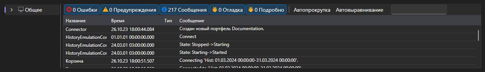

# Логи

Вкладка **Логи** показывает всё, что приложение сообщает о своей работе: сообщения подключения, стратегий, эмуляции и самой оболочки.

Каждая запись \- это время, уровень (отладка, сведения, предупреждение, ошибка), источник и текст. Записи стратегий помечены идентификатором стратегии, поэтому при нескольких одновременно работающих стратегиях видно, чьё это сообщение.

Над таблицей показано, сколько накопилось ошибок и предупреждений, и кнопка, очищающая журнал. Сама таблица умеет фильтровать записи по уровню, искать по тексту, выбирать колонки и выгружать содержимое.

Логи \- первое место, куда стоит заглянуть, если стратегия не запускается, не выставляет заявки или прогон на истории заканчивается сразу после начала.

## См. также

[Общее](common.md)
