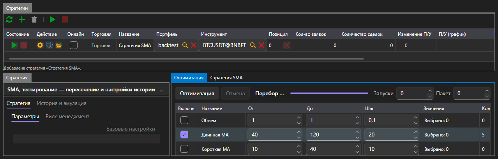

# Оптимизация

Вкладка **Оптимизация** подбирает параметры стратегии перебором: она запускает ту же стратегию на той же истории столько раз, сколько получается сочетаний параметров, и показывает результат каждого запуска.

Оптимизация доступна только в области [Эмуляция](emulation.md). В [Реал\-тайме](real_time.md) этой вкладки нет: перебирать параметры на живом подключении нечем.

## Что перебирать

В таблице параметров перечислены параметры выбранной стратегии, которые можно перебирать. Параметр участвует в переборе, только когда он отмечен галочкой; для отмеченного задаются начало, конец и шаг. Что именно можно ввести, зависит от типа параметра: у целого числа это целые значения, у булева \- только два значения.

Справа от кнопок задаются границы перебора:

| Поле | Что задаёт |
|---|---|
| **Запуски** | сколько прогонов сделать максимум; 0 \- без ограничения |
| **Пакет** | сколько прогонов выполнять одновременно |

Число сочетаний пересчитывается по мере того, как отмечаются параметры, поэтому видно заранее, во что выльется перебор.

## Ход перебора

Кнопка **Оптимизация** запускает перебор, **Отменить** останавливает его. Строка состояния говорит, что происходит: планируется перебор, выполняется столько\-то прогонов, перебор остановлен после стольких\-то прогонов, перебор не дал ни одного запуска. Полоса рядом показывает, сколько пройдено.

## Результат

Результат показан тремя способами одновременно:

- таблица, где каждая строка \- один прогон со своими значениями параметров, итоговой прибылью и кривой доходности;
- поверхность по двум выбранным параметрам;
- та же поверхность в виде тепловой карты.

Выбор строки в таблице показывает кривую доходности этого прогона.

## См. также

[Эмуляция](emulation.md)
