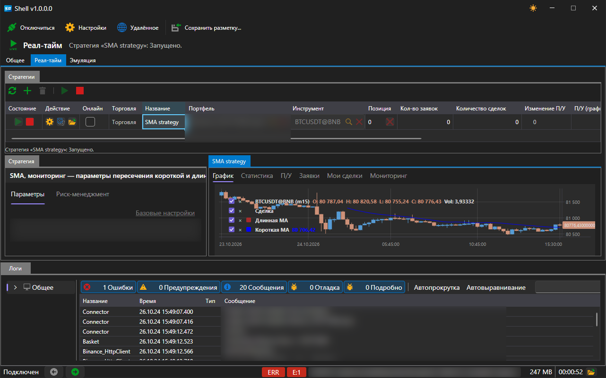

# Реал\-тайм

Вкладка **Реал\-тайм** управляет стратегиями, запущенными в торговлю.

Область состоит из трёх частей:

- **Стратегии** \- таблица всех стратегий области и кнопки управления ими, сверху;
- **Стратегия** \- параметры выбранной стратегии, слева;
- вкладки справа \- **График**, **Статистика**, **П/У**, **Заявки** и **Мои сделки**: всё, что выбранная стратегия показывает, выставила и совершила.

Работа с этой областью возможна только при установленном подключении: без него кнопки недоступны, а под таблицей показана подсказка об этом.

## Кнопки

| Кнопка | Что делает |
|---|---|
| **Обновить** | перечитывает список стратегий |
| **Добавить** | открывает окно выбора стратегии |
| **Удалить** | убирает выбранную стратегию из области |
| **Запустить** | запускает выбранную стратегию в торговлю |
| **Остановить** | останавливает её |

## Таблица стратегий

Каждая строка \- одна стратегия. Колонки показывают её состояние и результат:

| Колонка | Что показывает |
|---|---|
| **Состояние** | остановлена, запускается, работает, останавливается |
| **Действие** | запуск, остановка и закрытие позиции прямо из строки |
| **Онлайн** | получает ли стратегия данные в реальном времени |
| **Торговля** | режим торговли стратегии |
| **Название** | имя, заданное при добавлении |
| **Портфель**, **Инструмент** | на чём она торгует |
| **Позиция** | текущая позиция |
| **Кол\-во заявок**, **Количество сделок** | сколько заявок выставлено и сколько сделок совершено |
| **Изменение П/У**, **П/У (график)** | прибыль и убыток и их динамика |
| **Реализованная прибыль**, **Нереализованная прибыль** | закрытая и открытая часть результата |
| **Ошибка** | последняя ошибка стратегии, если она была |

## Добавление стратегии

Кнопка **Добавить** открывает окно со списком доступных стратегий.

В окне перечислены четыре стратегии из поставки и всё, что было импортировано из [Designer](../run_strategies_from_designer.md). Кнопка **Импорт** добавляет в этот список схему, выгруженную из Designer; кнопка **Создать** \- заготовку для собственной стратегии; кнопка **Удалить** убирает выбранную запись из списка.

После нажатия **OK** стратегия появляется в таблице, а на панели **Стратегия** открываются её параметры: инструмент, портфель, объём, правила риска и собственные параметры стратегии \- например, длины скользящих средних и таймфрейм свечей для **SMA strategy**.

## См. также

[Общее](common.md)

[Эмуляция](emulation.md)
