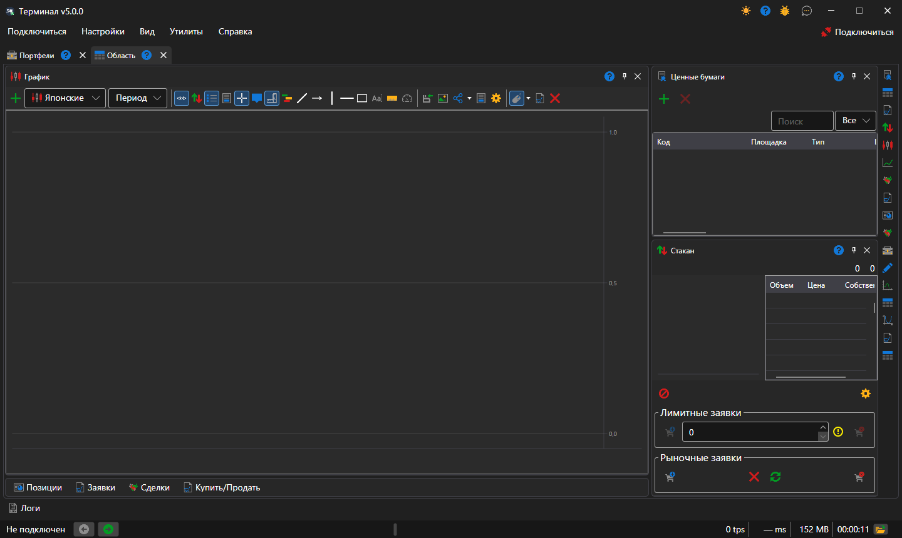
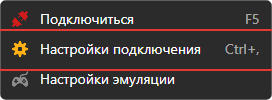
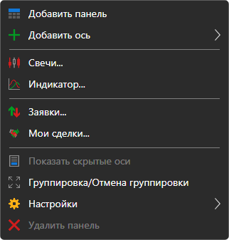
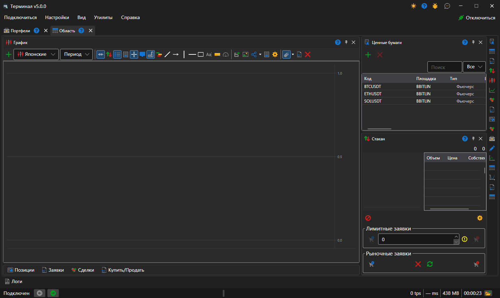
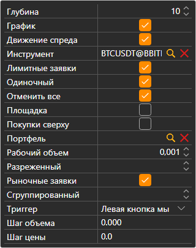
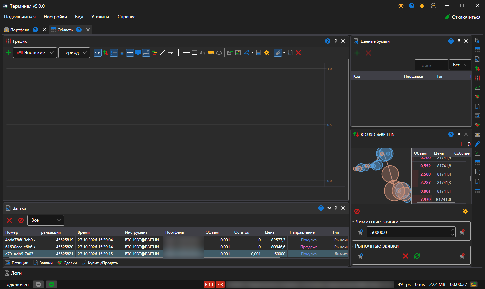
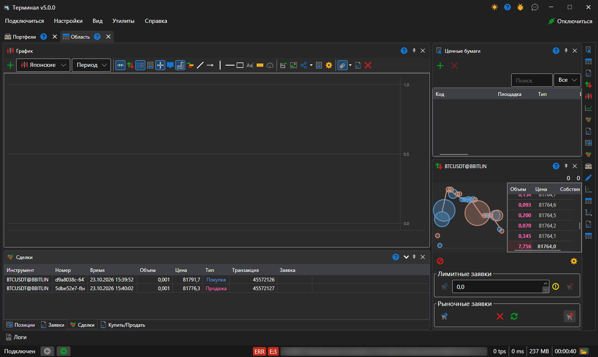
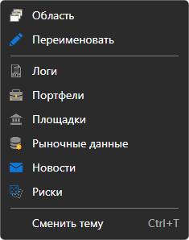

# Быстрый запуск

При первом запуске [Terminal](../terminal.md) откроется окно с одной [рабочей областью](user_interface/workspace.md), разложенной по умолчанию: график в центре, справа инструменты и стакан, под графиком свёрнутые вкладки позиций, заявок, сделок и тикета **Купить\/Продать**.

Перейдем в настройки подключения — меню **Подключиться → Настройки подключения** — и выберем необходимое подключение. Как настроить подключение описано в пункте [Настройки подключения](connection_settings.md).

Следующим шагом подключимся, нажав на кнопку **Подключиться** в конце строки [главного меню](user_interface/ribbon.md) или клавишу **F5**.

Нажав на кнопку **Добавить**  панели графика добавляем новую область графика. Нажав вторую кнопку мыши на области графика добавляем на нее свечи по интересующему нас инструменту. На график можно добавить индикаторы, собственные сделки и заявки. Также присутствует возможность выставления заявок с графика. Более подробно узнать как работать с графиком можно в пункте [График](user_interface/components/chart.md).

На панели инструментов нажав на кнопку **Добавить**  добавляем инструменты, которые хотим наблюдать, здесь будут отображаться данные по лучшим ценам. Более подробно узнать как работать с панелью инструментов можно в пункте [Инструменты](user_interface/components/instruments.md).

В стакане после нажатия на кнопку **Настройки**  появится панель, в которой укажем **Инструмент** и **Портфель** по которым будут проходить сделки. Также настроим глубину стакана. Более подробно узнать как работать со стаканом можно в пункте [Стакан](user_interface/components/order_book.md).

Отправим первые несколько заявок. Заявки можно отправлять как нажатием на кнопки **Купить\/Продать**, так и двойным щелчком по ячейке столбцов **Бид\/Офер** в самом стакане. На панели заявки отобразятся все наши заявки. При нажатии на вторую кнопку мыши на заявке появится панель с которой можно выставить новую заявку, отменить или заменить выбранную заявку. Более подробно узнать как работать с панелью заявок можно в пункте [Заявки](user_interface/components/orders.md).

На панели **Сделки** можно просмотреть сделки по инструментам. Более подробно узнать как работать с панелью сделок можно в пункте [Сделки](user_interface/components/trades.md).

При необходимости можно добавить дополнительные компоненты — кнопками полосы у правого края рабочей области; панели всего окна, например **Портфели** и **Логи**, открываются из меню **Вид**. Все компоненты описаны в пункте [Компоненты](user_interface/components.md).

