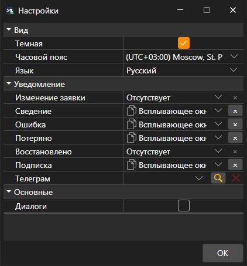

# Общие настройки

Окно **Настройки** открывается пунктом **Настройки → Настройки** [главного меню](../user_interface/ribbon.md). Настройки в нём разделены на группы:

- **Вид**:
  - **Темная** — тёмная тема оформления; её же переключает кнопка в заголовке окна;
  - **Часовой пояс** — в каком часовом поясе показывается время маркет-данных;
  - **Язык** — язык программы.
- **Основные**:
  - **Диалоги** — показывать окно с ошибкой, которую программа не обработала сама. Если флажок снят, такая ошибка только записывается в журнал.
- **Уведомление** — о каких событиях заявок и подключения сообщать и каким способом, а также канал Telegram для таких сообщений. Подробно — в разделе [Уведомления](../notifications.md).

Тема оформления меняется сразу после нажатия **OK**. Язык и часовой пояс вступают в силу после перезапуска, поэтому Terminal спрашивает, перезапуститься ли сейчас.

## См. также

[Сброс настроек](reset_settings.md)

[Уведомления](../notifications.md)
