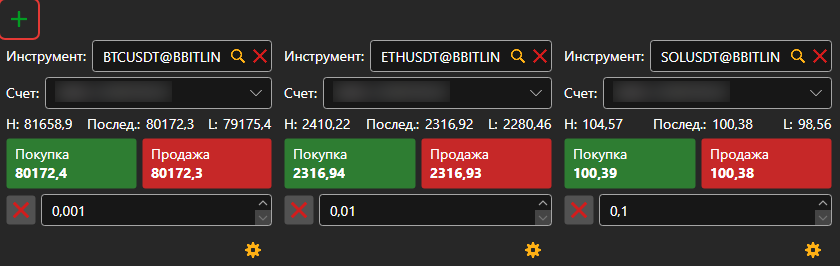
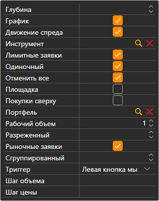

# Купить\/Продать

Компонент **Купить\/Продать** — группа тикетов. Каждый тикет показывает лучшие цены одного инструмента и выставляет по нему заявки на выбранный портфель. Тикет добавляется кнопкой ; при первом подключении панель сама заводит тикеты по первым инструментам площадки.

## Настройки тикета

Кнопка с шестерёнкой под тикетом открывает его настройки: **Инструмент**, **Портфель**, **Рабочий объем**, **Глубину** стакана и то, какие блоки тикет показывает:

- **Лимитные заявки** — кнопки **Купить** и **Продать** с полем цены между ними; кнопки рядом с полем подставляют в него лучшую цену покупки или продажи;
- **Рыночные заявки** — **Купить**, **Продать**, **Закрыть позицию** и **Перевернуть позицию** по рынку;
- **Отменить все** — кнопка, снимающая все заявки по инструменту тикета.

Инструмент тикета можно сменить, перетащив на тикет строку из [Инструментов](instruments.md); если перетащить строку из [Позиций](positions.md), тикет возьмёт её инструмент и портфель.

## Горячие клавиши

Тикет панели **Купить\/Продать** той [рабочей области](../workspace.md), что открыта сейчас, отвечает на клавиши: **F9** — купить по рынку, **F10** — продать по рынку, **Esc** — снять все заявки. Пока курсор стоит в поле ввода, клавиши не действуют.

> [!WARNING]
> **F9** и **F10** отправляют на площадку настоящие рыночные заявки без подтверждения.

## См. также

[Стакан](order_book.md)

[Level 2](level_2.md)

[Главное меню](../ribbon.md)
