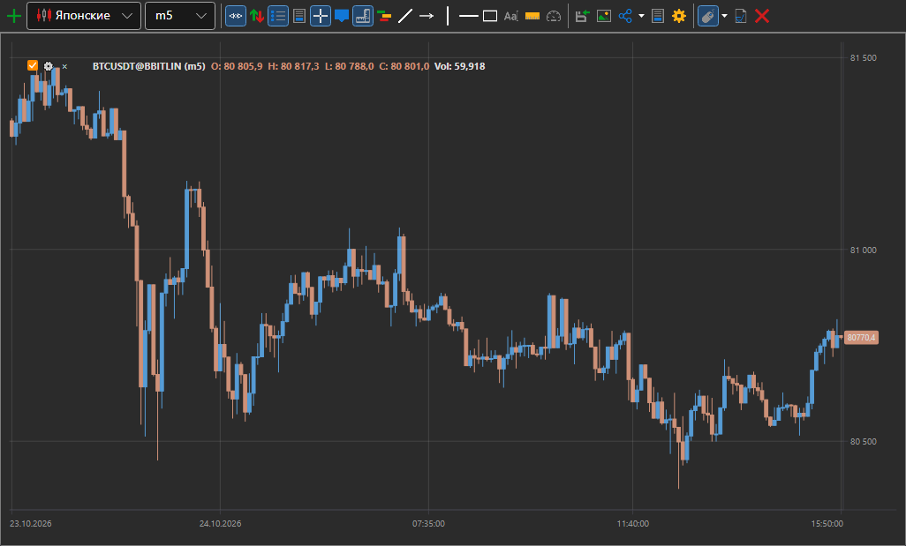
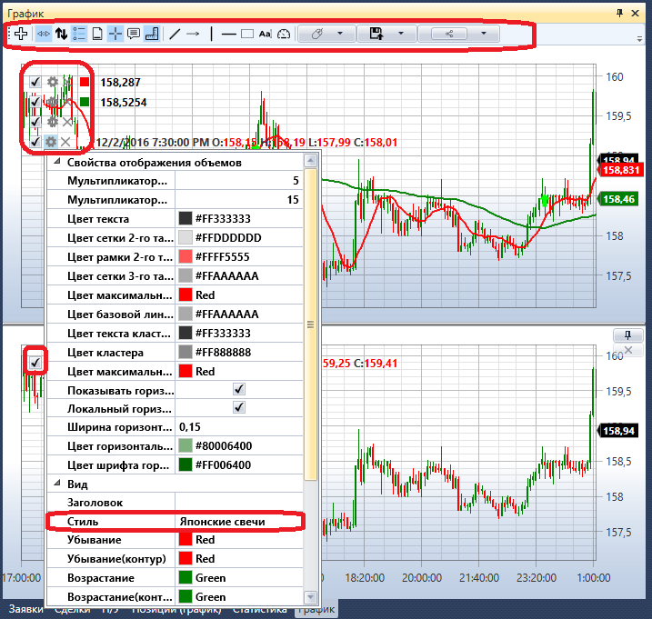
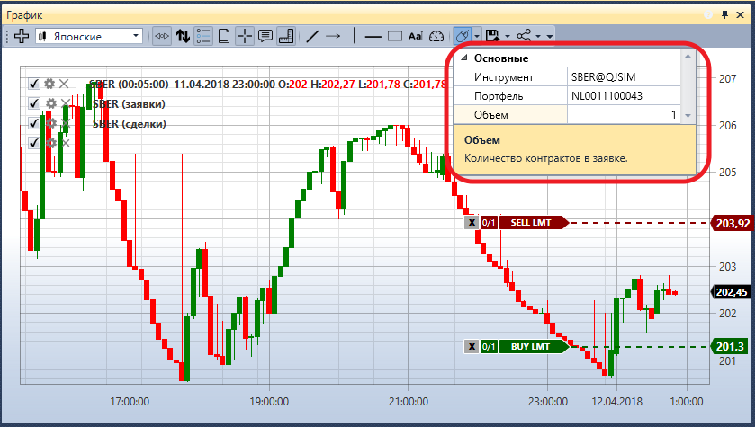
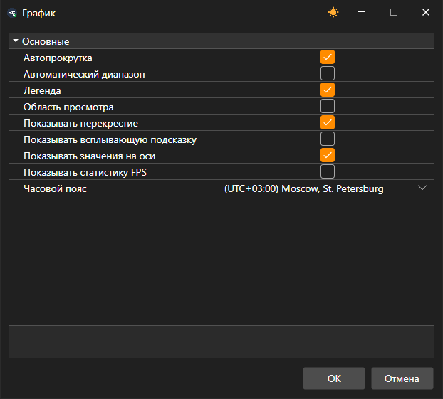
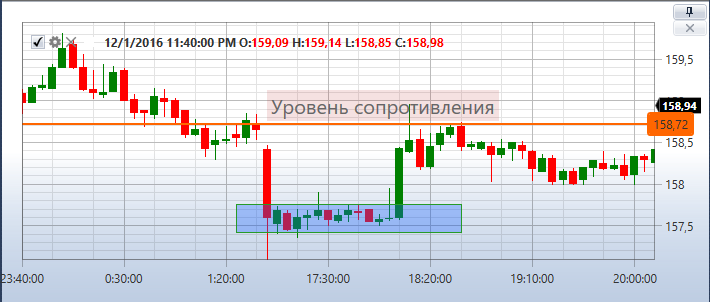

# График

Компонент **График** позволяет отрисовывать свечи и индикаторы по выбранному инструменту.

Для добавления новой области необходимо нажать на кнопку .

Для добавления нового элемента графика необходимо нажать на вторую кнопку мыши в произвольном месте области графика и выбрать необходимый элемент, это могут быть: свечи, индикаторы, заявки, собственные сделки.

В левом верхнем углу каждого графика показаны все графические элементы, добавленные на график. Если убрать флажок  на графическом элементе, уберется и элемент с графика. Нажав на кнопку , откроются настройки графического элемента.

## Торговля с графика

С графика можно выставлять, переносить и снимать заявки. Сначала включается переключатель **Выставлять заявки с графика** на панели кнопок графика, а в его выпадающих настройках указываются **Инструмент**, **Портфель** и объём заявки.

- Заявка на покупку выставляется сочетанием **Ctrl + ЛКМ** по цене на графике, заявка на продажу — **Ctrl + ПКМ**.
- Свои активные заявки нарисованы на графике линиями на их ценах. Линию можно взять и перетащить к другой цене — заявка будет перенесена; крестик у линии снимает заявку. Кнопка **Отменить заявки** снимает все заявки графика.
- Кнопка **Показывать панель для быстрого ввода заявок** выводит поверх графика панель с кнопками **Продать** по лучшей цене покупки и **Купить** по лучшей цене продажи, спредом между ними и объёмом заявки. Панель можно перетащить в любое место графика.

> [!WARNING]
> Заявки с графика отправляются на площадку сразу, без подтверждения.

## Настройки графика

Кнопка **Настройки** на панели кнопок графика открывает окно настроек всего графика: автопрокрутка и автомасштабирование, легенда, область просмотра, перекрестие, всплывающая подсказка, значения на осях, статистика FPS и часовой пояс, в котором подписана шкала времени.

Правый щелчок по самой панели кнопок открывает список её кнопок: снятый флажок прячет кнопку, отмеченный возвращает её. Какие кнопки показаны, сохраняется вместе с графиком.

Кнопка **Буфер обмена (изображение)** копирует картинку графика, чтобы вставить её в сообщение или документ. Правый щелчок по элементу графика открывает меню с пунктами **Параметры элемента…** и **Удалить**; в меню области графика есть **Настройки → Область графика…** и **Удалить панель**. Панель под графиком закрывается и крестиком в её заголовке.

График прокручивается стрелками **←** и **→**, клавиши **Home** и **End** переходят к началу и концу данных, **+** и **−** меняют масштаб.

В настройках графического элемента можно установить необходимый стиль графика: японские свечи, бары, боксовый график, кластерный профиль и др.

Для боксового графика свечи можно дополнительно группировать, порядок группировки устанавливается в полях: мультипликатор 2\-го таймфрейма, мультипликатор 3\-го таймфрейма.

Над графиком расположена лента инструментов, на которой можно выбрать режимы автопрокрутки, авто\-масштабирования, показа легенды и других общих настроек графика. Также можно выбрать элементы для рисования на графике: линии, уровни, указатели, прямоугольник, текст.

## См. также

[Заявки](../../../designer/user_interface/components/orders.md)
