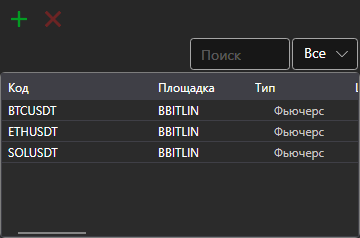

# Инструменты

Компонент **Инструменты** (заголовок панели — **Ценные бумаги**) представляет собой таблицу с инструментами, в которой отображается информация о всех выбранных инструментах.

Для добавления нового инструмента необходимо нажать на кнопку . Откроется окно выбора инструментов: в нём есть поиск, фильтр по типу инструмента и по площадке, а пока список инструментов загружается, под таблицей видна полоса загрузки. Кнопка **Удалить инструменты** убирает выделенные инструменты из таблицы.

Инструмент, выделенный в таблице, показывается в панели **Свойства** этой же рабочей области. Если у графика области ещё нет инструмента, для которого он выставляет заявки, им становится выделенный инструмент.

Строку инструмента можно перетащить мышью на другую панель области — [Купить/Продать](buy_sell.md), [Level 1](level_1.md), [Level 2](level_2.md), [Стакан](order_book.md) или [График](chart.md), — и панель переключится на этот инструмент.

Как копировать строки, искать и фильтровать их и настраивать колонки, описано в разделе [Работа с таблицами](../tables.md).

## См. также

[Level 1](level_1.md)
