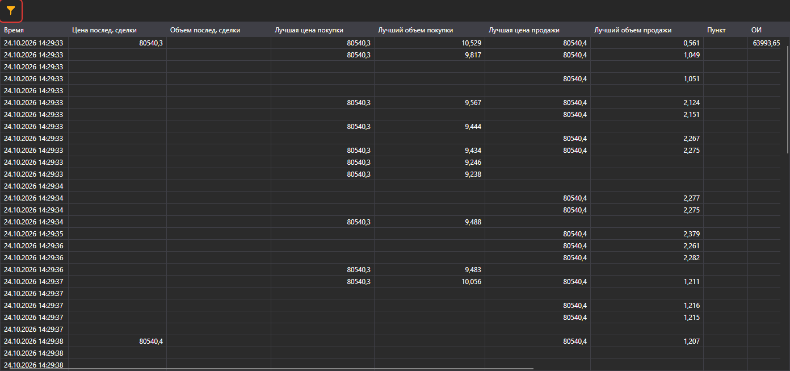

# Level 1

Компонент **Level 1** представляет собой таблицу с историей изменения **Level 1** по выбранным инструментам.

**Level 1** имеет фильтр для выбора необходимых инструментов.

## См. также

[Купить\/Продать](buy_sell.md)
