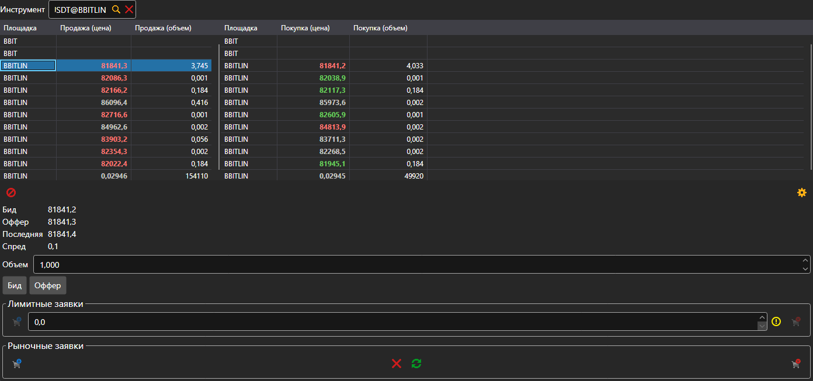

# Level 2

Компонент **Level 2** показывает котировки инструмента на всех площадках сразу: в таблицы попадает каждый инструмент с тем же кодом, по строке на инструмент. В левой таблице — лучшая цена и объём продажи, в правой — покупки. Инструмент выбирается в поле над таблицами или перетаскивается на панель из [Инструментов](instruments.md).

Под таблицами — бид, оффер, последняя цена и спред строки, выбранной в таблице. Кнопки **Бид** и **Оффер** подставляют эту цену в лимитную заявку, а ниже — тот же тикет, что в компоненте [Купить\/Продать](buy_sell.md): лимитные и рыночные заявки.

## См. также

[Стакан](order_book.md)

[Купить\/Продать](buy_sell.md)
