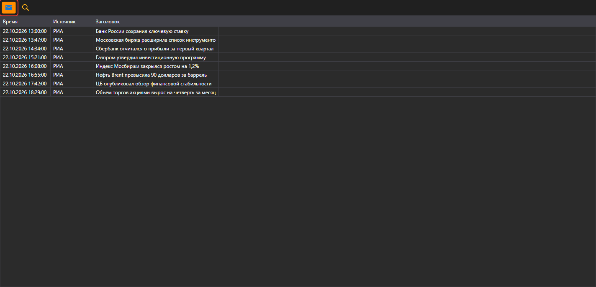

# Новости

Компонент **Новости** предназначен для отображения новостей, полученных из подключений.

Для начала получения новостей необходимо нажать кнопку **Получать новости**.

## См. также

[Позиции (опционы)](positions_options.md)
