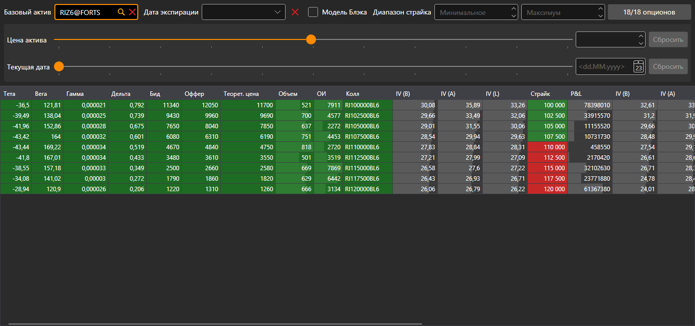

# Доска опционов

Компонент **Доска опционов** представляет собой таблицу основных параметров опционов по базовому инструменту: строка таблицы — страйк, слева параметры колла, справа — пута.

## Фильтр опционов

Над таблицей стоит фильтр. Он одинаков у всех опционных компонентов — доски, [улыбки волатильности](smile_volatility.md) и [позиций по опционам](positions_options.md):

- **Базовый актив** — инструмент, опционы на который показываются;
- **Дата экспирации** — показывать опционы только этой даты экспирации; кнопка рядом очищает фильтр;
- **Модель Блэка** — считать теоретические цены, волатильность и «греки» по модели Блэка (для опционов на фьючерсы), а не по модели Блэка — Шоулза;
- **Диапазон страйка** — минимальный и максимальный страйк;
- кнопка с числом опционов открывает окно выбора опционов базового актива. На кнопке видно, сколько выбранных опционов проходит фильтр и сколько их выбрано всего.

Под фильтром — расчёт «что если». Ползунок **Цена актива** и поле рядом с ним задают другую цену базового актива, ползунок **Текущая дата** и календарь — другую текущую дату. Расчёты компонента ведутся для этих значений, а кнопки **Сбросить** возвращают настоящие цену и дату.

## Таблица

Страйки «в деньгах» подсвечены: у колла это страйки ниже цены базового актива, у пута — выше.

Двойной щелчок по ячейке колла или пута открывает стакан этого опциона.

## См. также

[Улыбка волатильности](smile_volatility.md)
