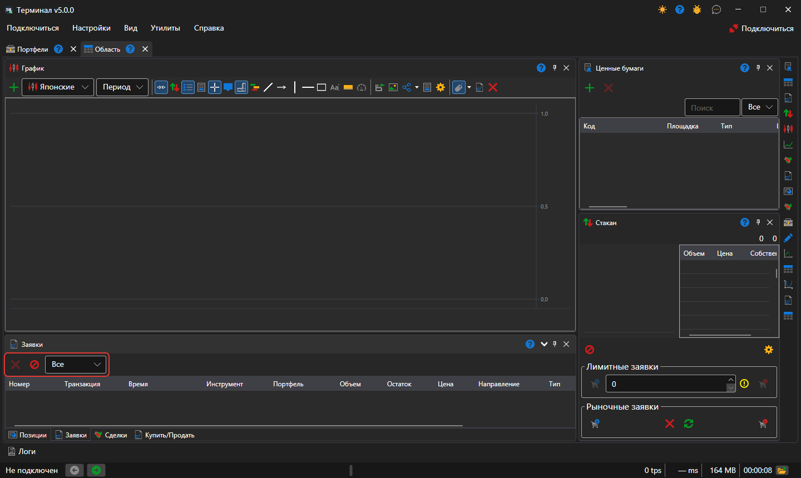
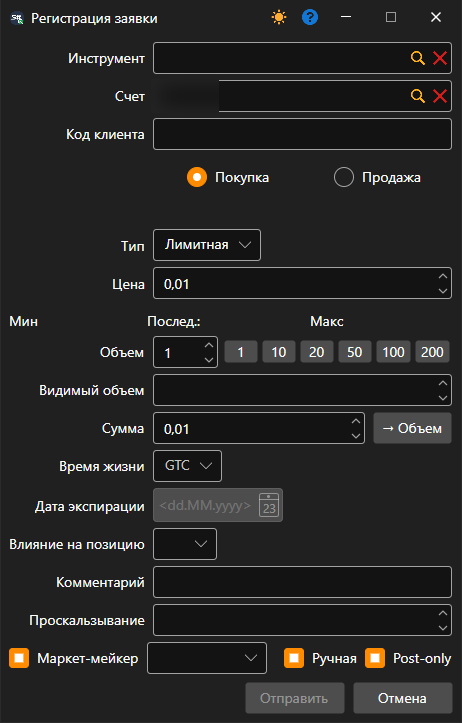
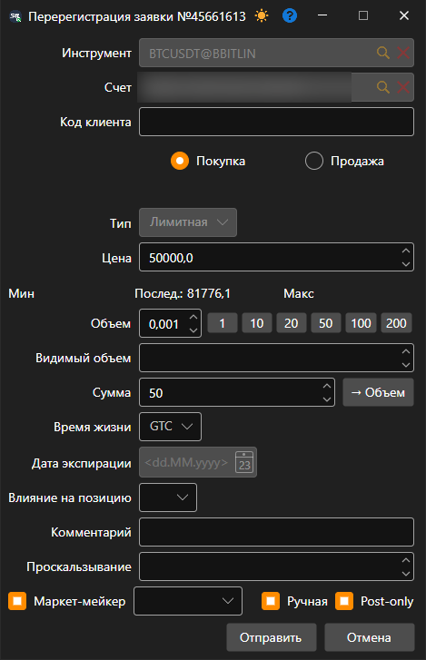

# Заявки

Компонент **Заявки** представляет собой таблицу с заявками, в которой отображается полная информация о всех заявках.

Над таблицей стоят две кнопки: **Отмена** снимает выбранную заявку, **Отменить все заявки** — все активные. Рядом с ними список, какие заявки показывать в таблице: все, активные, исполненные или отклонённые.

При нажатии на вторую кнопку мыши на заявке появится панель, с которой можно выставить новую заявку, отменить или заменить выбранную заявку.

При нажатии на кнопку **Регистрация заявки** появится окно. Для выставления новой заявки его необходимо заполнить и нажать кнопку **Отправить**.

При нажатии на кнопку **Заменить заявку** появится окно. Для замены заявки необходимо внести требуемые изменения и нажать кнопку **Отправить**.

## См. также

[Сделки](../../../designer/user_interface/components/trades.md)
