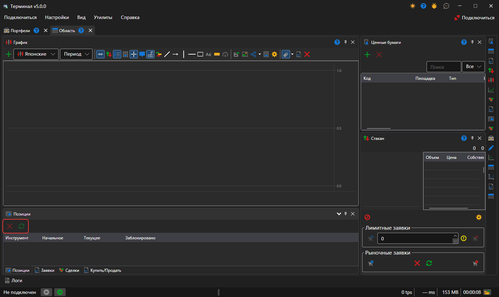

# Позиции

Компонент **Позиции** — таблица текущих позиций по инструментам и портфелям: объём, средняя цена, прибыль и убыток.

Над таблицей стоят кнопки **Закрыть позицию** — заявка по рынку, которая приводит выбранную позицию к нулю, — и **Перевернуть позицию** — заявка по рынку на двойной объём позиции, после которой позиция становится такой же по размеру, но в другую сторону. Строку позиции можно перетащить на тикет [Купить\/Продать](buy_sell.md): тикет возьмёт её инструмент и портфель.

## См. также

[Позиции](../../../designer/user_interface/components/positions.md)

[Купить\/Продать](buy_sell.md)
