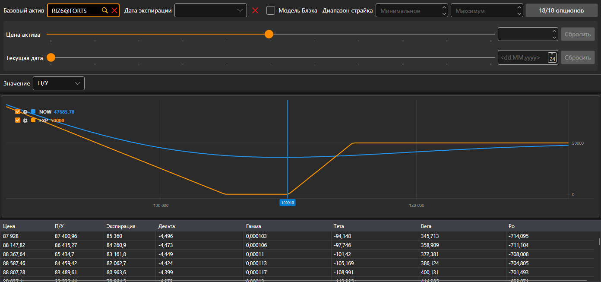

# Позиции (опционы)

Компонент **Позиции (опционы)** представляет собой графическое отображение позиции по опционам: как её показатель зависит от цены базового актива.

Опционы выбираются тем же фильтром, что и на [доске опционов](option_desk.md): базовый актив, дата экспирации, диапазон страйков и сами опционы. Расчёт «что если» под фильтром показывает позицию при другой цене базового актива и на другую дату.

В списке **Значение** выбирается, что строить: **П/У**, **Дельта**, **Гамма**, **Тета**, **Вега** или **Ро**. Под графиком — таблица значений по ценам базового актива: **Цена**, П/У сейчас, П/У на **Экспирацию** и «греки».

## См. также

[Доска опционов](option_desk.md)
