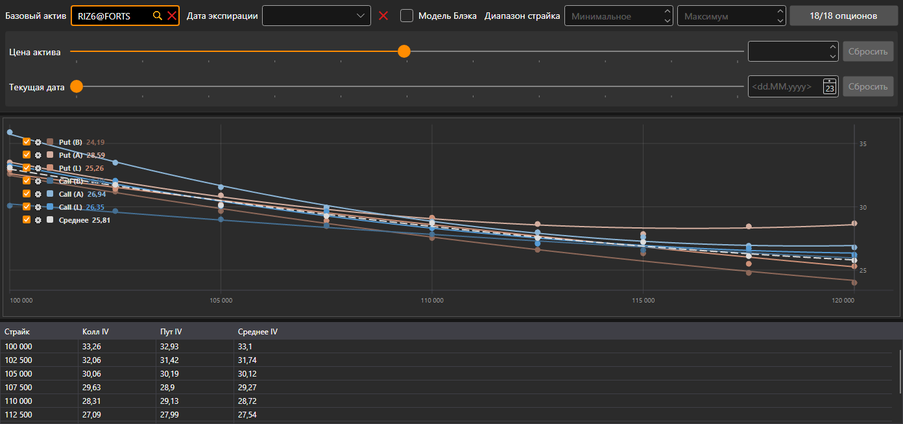

# Улыбка волатильности

Компонент **Улыбка волатильности** представляет собой графическое отображение ожидаемого уровня волатильности по опционам с одинаковым базовым активом и разными страйками.

Опционы выбираются тем же фильтром, что и на [доске опционов](option_desk.md): базовый актив, дата экспирации, диапазон страйков и сами опционы.

На графике семь кривых: подразумеваемая волатильность коллов и путов по лучшей цене покупки, по лучшей цене продажи и по цене последней сделки, а пунктиром — **Среднее** волатильности колла и пута на каждом страйке. Под графиком — таблица: **Страйк**, волатильность **Колла** и **Пута** (по цене последней сделки, а если сделок не было — по лучшей цене покупки или продажи) и их **Среднее**.

## См. также

[Доска опционов](option_desk.md)

[Позиции (опционы)](positions_options.md)
