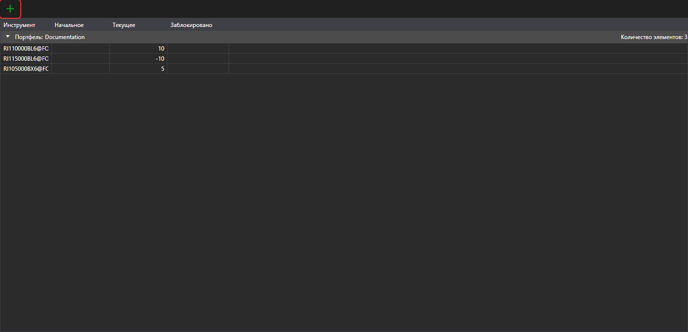

# Портфели

Панель **Портфели** показывает сведения о портфелях и связанные с ними позиции. Она открывается пунктом **Вид → Портфели** [главного меню](ribbon.md).

Кнопка  создаёт позицию, а её выпадающее меню — портфель или позицию. Двойной щелчок по строке открывает позицию для редактирования.

В меню, которое открывается правым щелчком по строке, кроме общих пунктов [таблиц](tables.md), есть:

- **Редактировать** — открыть позицию для редактирования;
- **Закрыть позицию** — выставить рыночную заявку, которая закрывает позицию;
- **Перевернуть позицию** — выставить рыночную заявку на объём вдвое больше позиции, чтобы позиция сменила направление;
- **Вывод** — вывести средства с площадки: в окне указываются объём и реквизиты вывода. Пункт доступен для положительной позиции по активу, если подключение портфеля поддерживает вывод средств;
- **Скрывать нулевые балансы** — не показывать позиции с нулевым остатком.

Подробнее о портфелях, позициях и их редактировании — в общем руководстве: [Портфели](../../designer/user_interface/portfolios.md).
