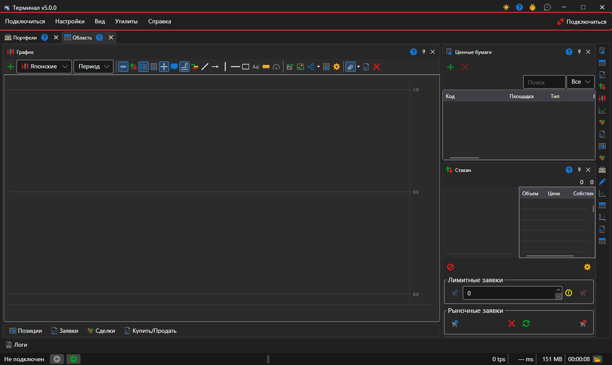

# Главное меню

Под заголовком окна [Terminal](../../terminal.md) идёт строка меню: **Подключиться**, **Настройки**, **Вид**, **Утилиты** и **Справка**. В конце строки стоит кнопка **Подключиться**: она подключает Terminal ко всем [настроенным подключениям](../connection_settings.md), а пока подключение установлено, называется **Отключиться**. Пока Terminal подключён, настройки подключений и эмулятора недоступны.

В заголовке окна, рядом с кнопками сворачивания и закрытия, стоят кнопки смены темы оформления, справки, **Сообщить о проблеме** и **Напишите нам**.

## Пункты меню

- **Подключиться** — подключение и отключение, [настройки подключений](../connection_settings.md) и настройки эмулятора, который исполняет заявки на настоящих рыночных данных, не отправляя их на площадку.
- **Настройки** — [общие настройки](../settings/common_settings.md) программы; **Сохранить разметку** и **Сбросить разметку**, которая возвращает панели на исходные места; [сброс настроек](../settings/reset_settings.md); окна **Инструменты и подключения** и **Портфели и подключения**, в которых инструменту или портфелю назначается подключение, через которое он торгуется.
- **Вид** — новая [рабочая область](workspace.md) (**Область**) и переименование текущей (**Переименовать**); панели всего окна: [Логи](logs.md), [Портфели](portfolios.md), [Редактор площадок](board_editor.md), **Маркет-данные**, [Новости](components/news.md), [Риски](risk_management.md); смена темы оформления.
- **Утилиты** — **Создание нового инструмента**, **Новый индексный инструмент** из нескольких инструментов и **Непрерывный инструмент** из фьючерсов разных сроков; созданный инструмент сразу появляется в [Инструментах](components/instruments.md) открытой области.
- **Справка** — **Документация**, **Отчет об ошибках**, связь с командой StockSharp и окно **О программе**.

## Горячие клавиши

| Клавиши | Действие |
|---|---|
| **F5** | подключиться или отключиться |
| **Ctrl+,** | настройки подключений |
| **Ctrl+S** | сохранить разметку |
| **Ctrl+T** | сменить тему оформления |
| **F1** | открыть справку |
| **Alt+C**, **Alt+S**, **Alt+V**, **Alt+T**, **Alt+H** | открыть меню **Подключиться**, **Настройки**, **Вид**, **Утилиты**, **Справка** |
| **F9** | купить по рынку в активном тикете [Купить/Продать](components/buy_sell.md) |
| **F10** | продать по рынку в активном тикете |
| **Esc** | снять все заявки активного тикета |

Активный тикет — тикет панели **Купить/Продать** той рабочей области, что открыта сейчас. Клавиши **F9**, **F10** и **Esc** не действуют, пока курсор стоит в поле ввода.

> [!WARNING]
> **F9** и **F10** отправляют на площадку настоящие рыночные заявки без подтверждения.

## См. также

[Рабочая область](workspace.md)

[Компоненты](components.md)
