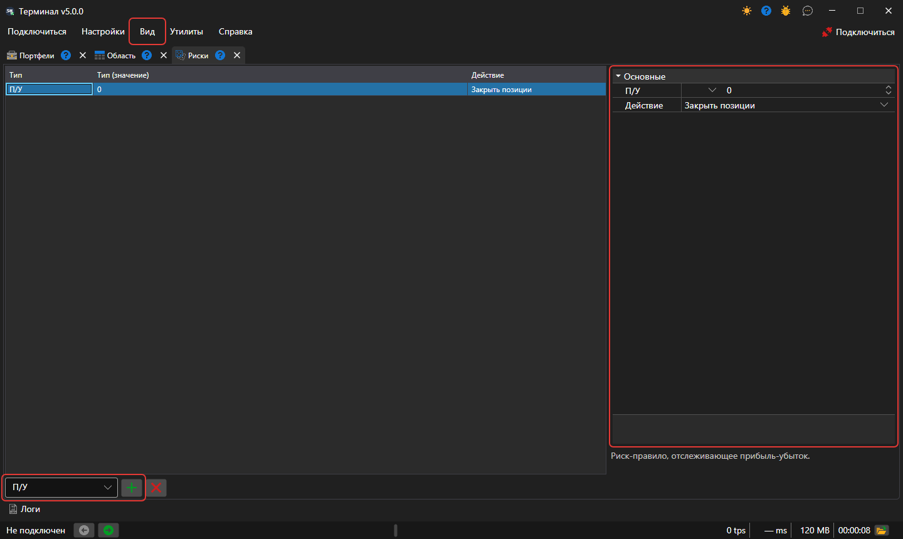

# Риск\-менеджмент

На панели **Риски** можно установить настройки контроля рисков. Панель открывается пунктом **Вид → Риски** [главного меню](ribbon.md).

Чтобы добавить **Риск\-правило**, нужно выбрать его тип в списке под таблицей и нажать кнопку **Добавить правило**. Правило появится в таблице, а справа — его настройки: условие срабатывания **Риск\-правила** и действие (Закрыть позиции, Остановить торговлю, Отменить заявки), которое будет выполняться при наступлении условия. Под настройками показано описание выбранного правила. Кнопка **Удалить правило** удаляет выделенные правила.

Правила проверяет подключение Terminal — на заявках, сделках и данных портфеля, которые через него проходят. Набор правил сохраняется между запусками программы.

Список риск\-правил и их описание доступно в разделе [Риск\-менеджмент](../../designer/user_interface/risk_management.md).
