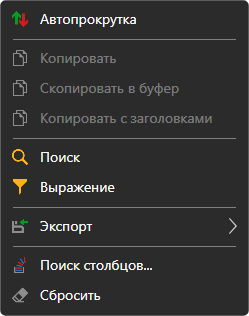
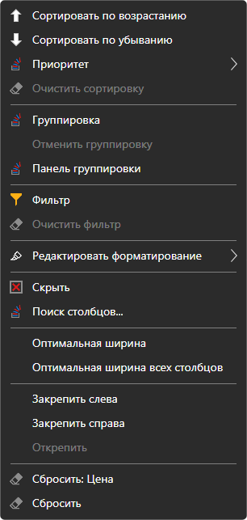

# Работа с таблицами

Таблицы всех панелей [Terminal](../../terminal.md) — инструменты, заявки, сделки, позиции, портфели, Level 1, лог заявок, новости — устроены одинаково.

## Меню таблицы

Правый щелчок по строкам таблицы открывает меню:

- **Автопрокрутка** — таблица сама прокручивается к новым строкам;
- **Копировать**, **Скопировать в буфер** — копируют выделенные строки в буфер обмена: видимые колонки в том порядке, в каком они показаны, через табуляцию, строка таблицы — строка текста. **Копировать с заголовками** добавляет первой строкой названия колонок. То же, что **Копировать**, делает **Ctrl+C**;
- **Поиск** (**Ctrl+F**) — поиск текста в таблице. Можно выбрать, в каких колонках искать; кнопки **Предыдущее** и **Следующий** переходят между найденными ячейками, **Очистить** сбрасывает поиск;
- **Выражение** — фильтр строк условием на значения колонок, в виде формулы, например `=[Price] > 100`. Поле подсказывает имена колонок и функции (`CONTAINS`, `STARTSWITH`, `ENDSWITH`, `TODAY`, `NOW` и другие), ошибку в формуле показывает сразу, а **Предпросмотр** — что формула даёт для выделенной строки. **Применить** включает фильтр, **Очистить фильтр** снимает его;
- **Экспорт** — таблица в буфер обмена (текстом в формате CSV или картинкой), в файл CSV, Excel или PNG. **Поделиться ссылкой на изображение** выкладывает картинку таблицы на сайт StockSharp и копирует ссылку на неё, для этого нужно войти на сайт. **Печать** открывает таблицу в браузере, откуда её можно напечатать;
- **Поиск столбцов...** — окно, в котором колонки показываются и скрываются;
- **Сбросить** — вернуть таблице исходный вид.

## Меню колонки

Правый щелчок по заголовку колонки открывает меню этой колонки:

- **Сортировать по возрастанию**, **Сортировать по убыванию**, **Очистить сортировку**. Щелчок по заголовку тоже сортирует таблицу по этой колонке. **Приоритет** добавляет сортировку по колонке к уже заданной, чтобы сортировать по нескольким колонкам сразу;
- **Группировка** — сгруппировать строки по значениям колонки, **Отменить группировку**. **Панель группировки** показывает уровни группировки: колонку можно добавить из списка или перетащить на панель за заголовок, уровни переставляются, у каждого уровня своё направление сортировки;
- **Фильтр** — фильтр строк по значениям этой колонки, **Очистить фильтр**;
- **Редактировать форматирование** — правила, по которым ячейки колонки выделяются цветом: **Добавить правило**, правило можно отредактировать, выключить или удалить;
- **Скрыть** — убрать колонку, **Поиск столбцов...** — вернуть её;
- **Оптимальная ширина** колонки и **Оптимальная ширина всех столбцов** — ширина по содержимому;
- **Закрепить слева**, **Закрепить справа**, **Открепить** — закреплённая колонка остаётся на месте при прокрутке таблицы вбок;
- **Сбросить** колонку или всю таблицу.

Вид таблицы — какие колонки показаны, их порядок и ширина — сохраняется вместе с раскладкой окна.

## См. также

[Рабочая область](workspace.md)

[Компоненты](components.md)
