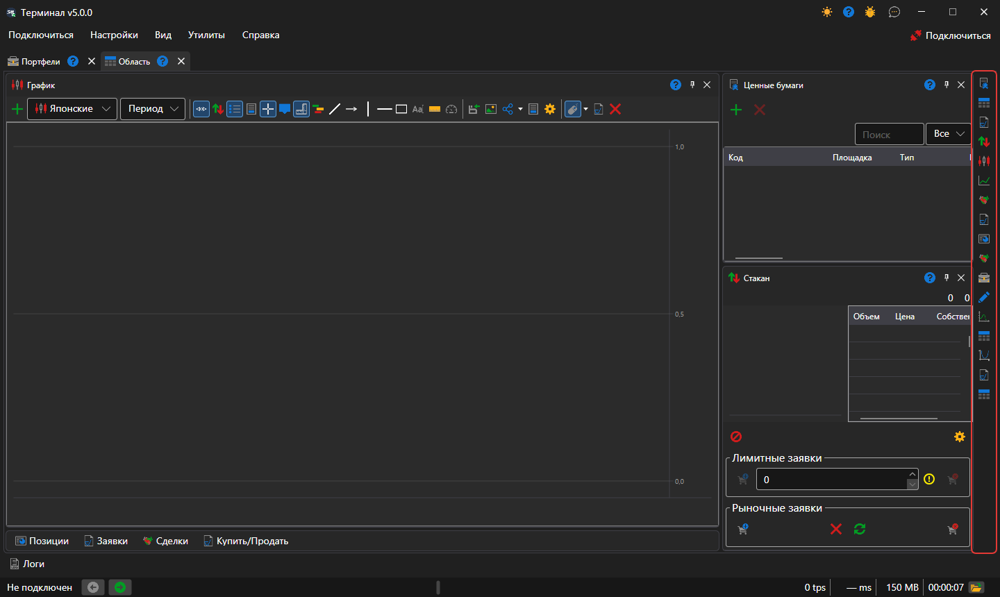
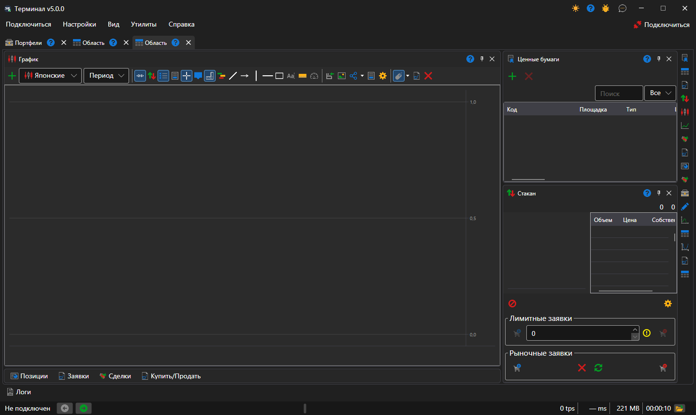

# Рабочая область

Рабочая область — вкладка окна [Terminal](../../terminal.md) со своим набором панелей: графиков, таблиц, тикетов. Областей может быть сколько угодно, и каждая живёт своей жизнью: инструмент, выбранный в одной, не меняет панели другой.

Новая область создаётся пунктом **Вид → Область** [главного меню](ribbon.md), текущая переименовывается пунктом **Вид → Переименовать**.

## Панели области

Панели добавляются кнопками вертикальной полосы у правого края области — по кнопке на каждый [компонент](components.md). Каждое нажатие открывает ещё одну панель этого вида, так что в одной области может быть, например, два графика по разным инструментам. Панель можно перетащить за заголовок в другое место области, пристыковать к краю соседней панели, сложить с ней во вкладки или вынести в отдельное окно.

## Раскладка новой области

Новая область разложена так, как принято в торговых терминалах: график в центре во всю высоту, справа [Инструменты](components/instruments.md) над [Стаканом](components/order_book.md), а таблицы **Позиции**, **Заявки**, **Мои сделки** и тикет **Купить/Продать** свёрнуты в строку вкладок под графиком. Щелчок по вкладке разворачивает таблицы, кнопка в их заголовке сворачивает обратно. Свёрнуты таблицы или нет, Terminal запоминает вместе с расположением панелей.

Расположение панелей Terminal сохраняет само при каждом изменении; **Настройки → Сохранить разметку** (Ctrl+S) сохраняет его немедленно, а **Настройки → Сбросить разметку** возвращает панели на исходные места.

## См. также

[Главное меню](ribbon.md)

[Компоненты](components.md)
