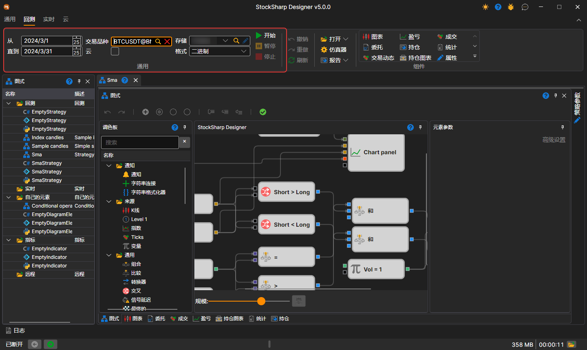
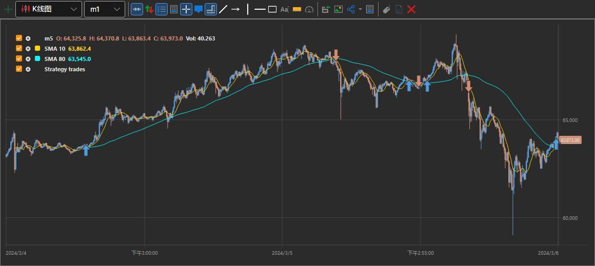
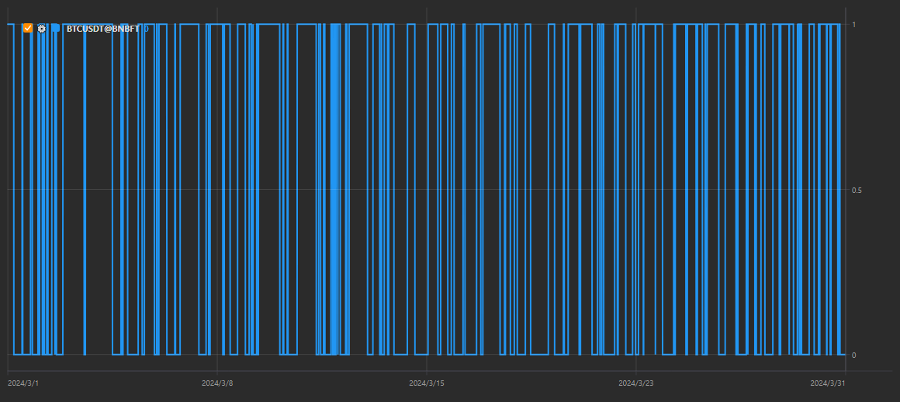
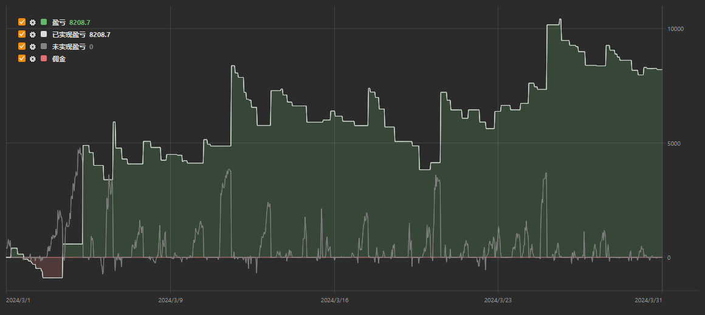

# 入门

下面以 SMA 策略为例。

要使用历史数据运行测试，请先选择需要回测的策略图。在策略文件夹的[策略图面板](../user_interface/schemas.md)中，双击所需策略即可将其选中。

测试前必须加载市场数据，包括交易品种、K线、逐笔成交和/或订单簿。具体方法请参阅[市场数据存储](../market_data_storage.md)。

切换到策略选项卡时，**功能区** 中会自动打开 **回测** 选项卡。请在此选项卡中设置测试时间段（**从** 和 **至**），在 **交易品种** 字段中选择交易品种，并在 **存储** 和 **格式** 字段中选择市场数据存储（参阅[市场数据存储](../market_data_storage.md)）及其写入格式。

SMA 策略示例使用以下参数：

1. 交易品种 BTCUSDT@BNBFT
2. 时间段为 2024年3月1日至2024年3月31日
3. 已加载该交易品种在此时间段内K线的存储
4. 存储格式 **二进制**

策略本身基于 5 分钟K线构建两条移动平均线——**SMA 10** 和 **SMA 80**，并按策略图中 **Vol = 1** 模块设定的数量进行交易。

设置完所有必需参数后，单击  按钮启动策略测试。

测试期间或测试完成后，可以查看包含测试信息的图表和表格。

图表表明，成交按照策略设计发生在移动平均线的交叉点。

从 **持仓图表** 可以看出，策略的持仓在 0 和 1 之间切换：短期均线自下而上穿过长期均线时，策略买入；出现反向交叉时，策略平仓。

**盈亏** 图表显示了测试期间策略盈亏的变化以及佣金。

## 推荐内容

[实盘运行](../live_execution/getting_started.md)
