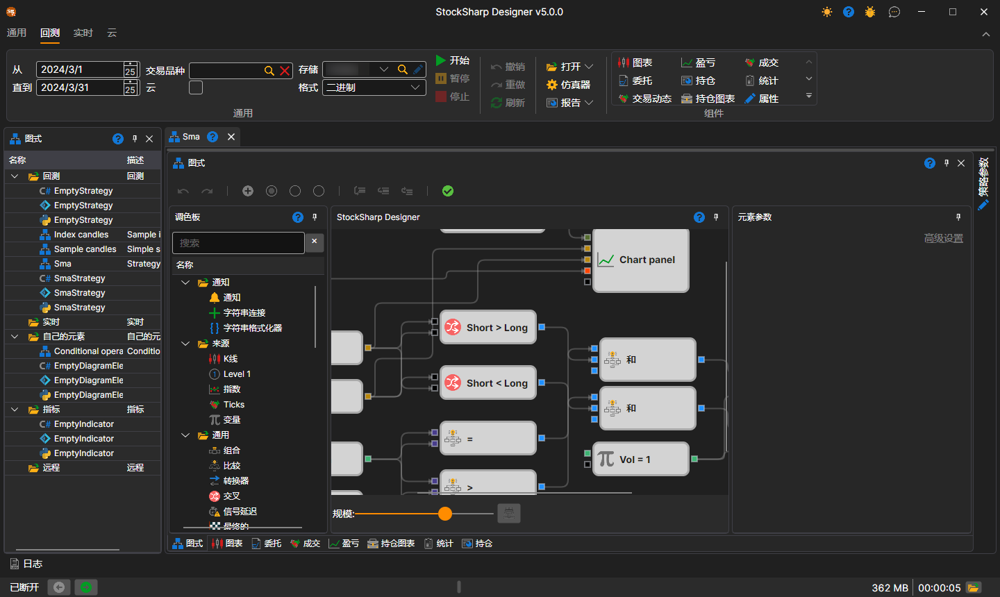
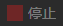

# 用户界面

要使用历史数据运行测试，请先选择需要回测的策略图。在策略文件夹的[策略图面板](../user_interface/schemas.md)中，双击所需策略即可选中该策略。将策略添加到工作区后，会显示一个新的策略选项卡；切换到该选项卡时，功能区中会自动打开 **回测** 选项卡。

**回测** 选项卡的 **通用** 组用于设置测试时间段（**从** 和 **至**）、**交易品种**、市场数据存储（**存储**）及其写入格式（**格式**）。勾选 **云** 复选框后，测试将在 StockSharp 云中运行，而不是在本机上运行。

单击 **开始** 按钮  启动策略测试。测试启动后，**暂停**  和 **停止**  按钮会变为可用状态：前者用于暂停测试，后者用于彻底停止测试。编辑策略时，还可以使用 **撤销** (Ctrl+Z)  撤销上一步操作，使用 **重做** (Ctrl+Y)  恢复被撤销的操作，并使用 **刷新** (Ctrl+R)  完整刷新策略图。

选项卡上的其他按钮：

- **打开** — 打开同一策略进行[优化](../optimization/brute_force.md)或[交易](../live_execution/getting_started.md)；
- **仿真器** — [模拟设置](../user_interface/components/backtesting_settings.md)；
- **报告** — 以 Excel、JSON、XML 或 CSV 格式生成已完成测试的报告；
- **组件** 组 — 可添加到策略选项卡的组件：图表、盈亏、成交等。

[调试器](debugging.md)（断点和逐步执行）位于 **策略图** 面板上。

默认情况下，所选策略的选项卡包含以下面板：

- **策略图** 面板：通过组合模块和连接线，完成策略及其组件的主要设计工作。有关策略图的详细说明，请参阅[图表面板](../strategies/using_visual_designer/diagram_panel.md)。
- 信息组件面板：**图表**、**委托**、**成交**、**盈亏**、**持仓图表**、**统计**、**持仓**，以选项卡形式显示在策略图下方。
- **策略参数** 面板：默认折叠在策略选项卡的右边缘，包含可在启动前修改的策略图参数。

## 推荐内容

[回测设置](../user_interface/components/backtesting_settings.md)
