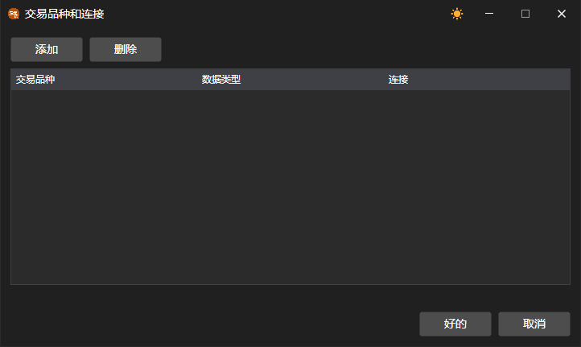

# 交易品种映射

同一交易品种在不同交易系统中可能使用不同的名称，其数据和订单也可能通过不同的连接传输。为此，[Designer](../../designer.md) 提供了三个窗口。

## 代码映射

市场数据面板上的 **代码映射** 按钮会打开 **交易品种代码 <\-> 适配器代码** 窗口。在表格上方的列表中选择连接，单击  按钮添加一行，单击删除按钮删除选中的行。在 **交易品种代码** 和 **交易场所代码** 列中填写交易品种在 **Designer** 中的名称，在 **适配器代码** 和 **适配器中的交易场所代码** 列中填写所选连接对该交易品种的命名。

## 交易品种和连接

**通用** 选项卡上 **连接** 按钮下拉列表中的 **交易品种和连接** 项会打开一个窗口，可在其中为交易品种和数据类型选择接收这些数据所用的连接。**添加** 按钮会添加一行，在该行中填写 **交易品种**、**数据类型** 和 **连接** 列；**删除** 按钮会删除选中的行。

## 投资组合和连接

同一列表中的 **投资组合和连接** 项会打开一个同样的窗口，用于投资组合：在 **组合** 列中指定投资组合，在 **连接** 列中指定通过哪个连接发送该投资组合的订单。

在 [Terminal](../../terminal.md) 中，这两个窗口都可以通过[主菜单](../../terminal/user_interface/ribbon.md)的 **设置** 菜单打开。
