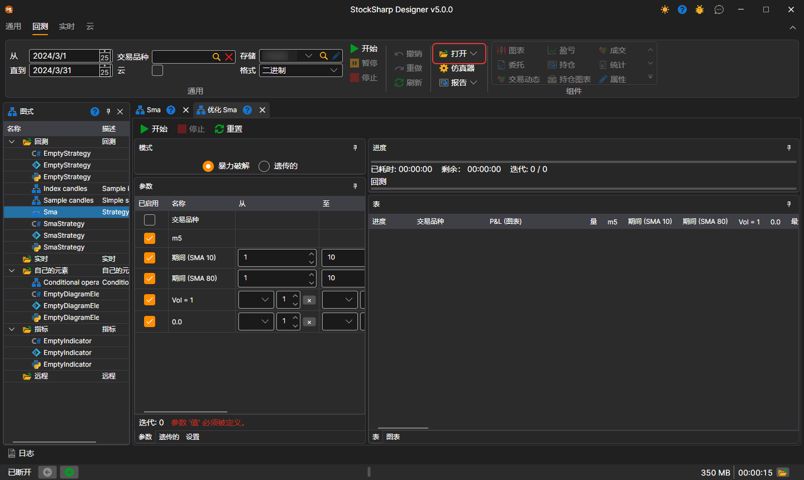
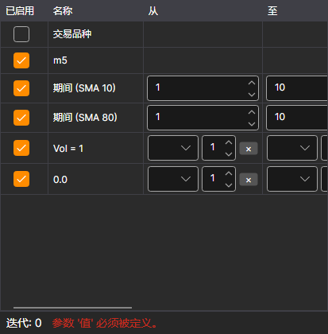
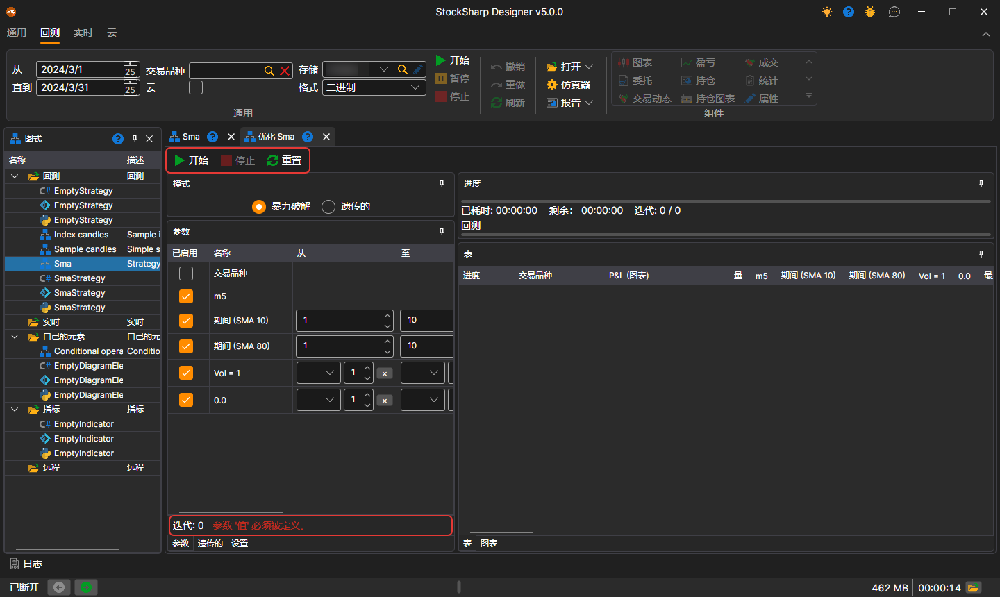

# 穷举优化

要切换到策略优化模式，请在 **回测** 选项卡中打开 **打开** 下拉列表并选择 **优化**。下面使用通过[模块](../strategies/using_visual_designer/first_strategy.md)创建的 SMA 策略介绍优化过程。

工作区会打开名为“优化 + 策略名称”的选项卡。**优化** 选项卡分为两个区域：左侧设置优化什么以及如何优化，右侧显示优化结果：

- 左上方是 **模式**：**暴力破解** 或 **遗传的**。其下有以下选项卡：**参数** — 要[遍历](optimization_parameters.md)的策略参数；**遗传的** — [遗传算法](genetic.md)设置；**设置** — 模拟设置和优化器本身的设置，例如同时执行多少次运行（**并行**）以及允许多少次迭代（**迭代**）。
- 右侧是 **进度**：已用时间、预计剩余时间，以及已完成的迭代数与计划迭代数。其下是 **表** 选项卡（每一行都表示使用一组唯一参数测试策略得到的结果）和 **图表** 选项卡（以 [3D 图表](3d_chart.md)形式显示结果）。

设置遍历参数后，迭代次数可能超过 1000。启动优化器后，结果上方的进度区域会显示计划迭代总数、已完成数量以及预计完成所需时间：

## 参数表和面板按钮

参数表的每一行都会显示在给定的 **从**、**至** 和 **步长** 下该行产生多少个值（**数量** 列），以及该行存在什么问题（**错误** 列），例如步长导致遍历无法到达上限。表格下方显示遍历全部参数组合时的运行次数，以及第一个错误（如果有）。

**开始**、**停止** 和 **重置** 按钮直接位于优化器面板上，其下方是当前运行的进度条。结果表中有 **交易品种** 列，显示该次运行所用的交易品种。

## 另请参阅

[回测示例](../backtesting/getting_started.md)
