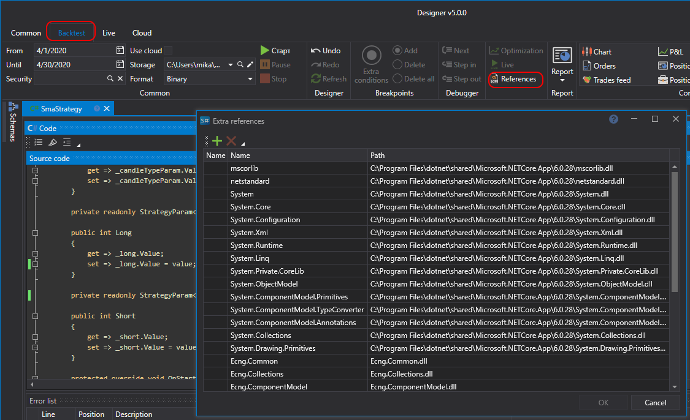

# 外部 DLL

通过 **源代码** 创建内容时，除 [API](../../../../api.md) 库外，还可以使用其他 C# 库，包括自定义库。这些库必须与 .NET 10 兼容。要添加库引用，请单击代码面板上的 **引用** 按钮。随后会打开 **额外的库** 窗口，可在其中添加或删除所需的库：

- **程序集** \- 添加对库文件的引用；
- **项目** \- 添加对在 Designer 中创建的自定义代码或指标的引用；
- **删除** \- 删除选中的引用。

引用表显示每个引用的名称、路径和状态，表格上方的 **搜索** 框可用于在长列表中查找引用。如果无法添加引用，表格下方会以红色显示原因。

