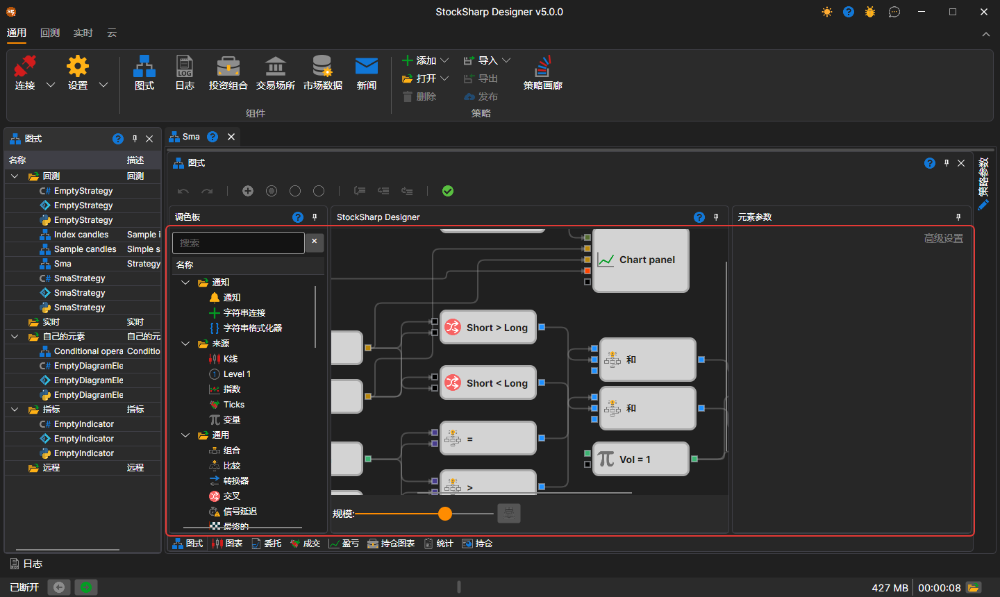
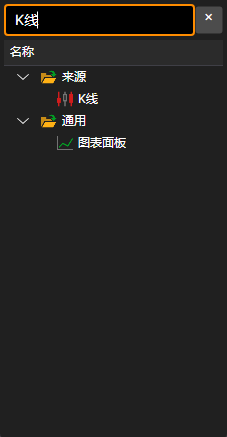
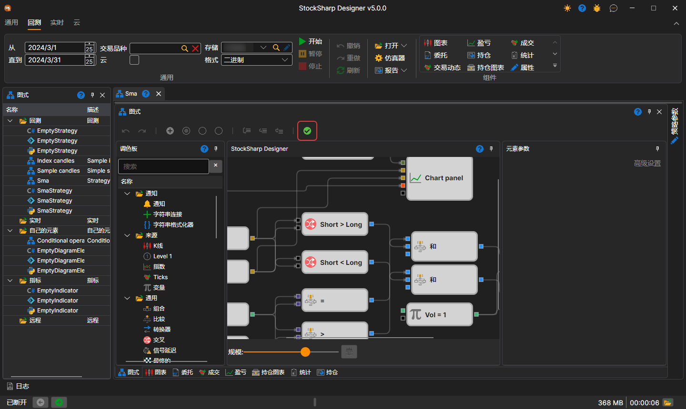
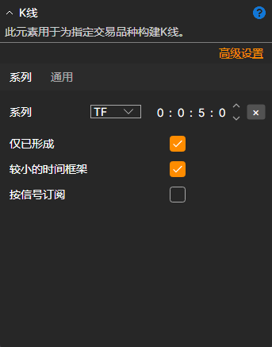
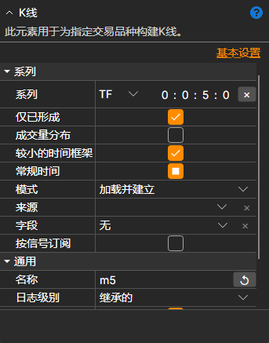

# 策略设计器

策略及其组成元素的主要设计工作在 **策略图** 面板中完成，用户通过组合模块和连接线构建策略。策略图面板由 **元素面板**、**设计器** 和 **元素参数** 三个面板组成。

## 元素面板

**元素面板** 面板包含用于创建策略的模块。面板中的全部元素按类别划分，详见[模块说明](elements.md)。要将模块添加到 **Designer** 面板，请在所需模块上按住鼠标左键，将其拖动到 **Designer** 面板后松开。双击模块会将其放到 **Designer** 面板的中央。随后程序会自动选中该元素，并在属性编辑窗口中显示模块参数。

元素面板上方的搜索框可以按名称、描述和类别名称查找模块。按 **Enter** 键会将选中的模块放到 **Designer** 面板上；如果未选中任何模块，则放置第一个找到的模块。

## Designer 面板

**Designer** 面板用于通过组合模块和连接线完成整个策略创建过程，并直观显示策略图。有关创建策略的详细说明，请参阅[通过模块创建算法](first_strategy.md)。

选中的模块可以用键盘方向键移动：每次移动一步，按住 **Shift** 时每次移动十步。拖动连接线时，只有可以连接该线的端口会高亮显示，线的末端会自动吸附到最近的端口。

策略图的缩放比例可以通过面板下方的 **规模** 滑块调整，也可以按住 **Ctrl** 并滚动鼠标滚轮调整。**Designer** 面板的快捷键：

| 按键 | 操作 |
|---|---|
| **Ctrl+Z**、**Ctrl+Y** | 撤销和重做操作 |
| **Ctrl+C**、**Ctrl+X**、**Ctrl+V** | 复制、剪切和粘贴选中的模块 |
| **Ctrl+A** | 选中所有模块 |
| **Delete** | 删除选中的内容 |
| **Esc** | 取消选择或中断连接线的拖动 |
| **Ctrl+“+”**、**Ctrl+“−”** | 放大和缩小 |
| **Ctrl+0** | 恢复原始缩放比例 |
| **Ctrl+1** | 使整个策略图适应面板大小 |
| **Alt+Z** | 使策略图适应面板大小，或恢复之前的缩放比例 |

策略图面板上带对勾的按钮（提示为 **通过生成并编译代码来验证图式**）可以在不运行策略的情况下检查策略图。如果策略图有错误，错误文本会以红色显示在 **Designer** 面板上方；调试器的错误也显示在那里。

## 元素参数面板

**元素参数** 面板显示 **Designer** 面板中当前选中模块的参数。选中的模块会以边框突出显示。

**元素参数** 面板支持两种显示模式：*基本设置* 和 *高级设置*。

默认情况下，构建策略图时首先以 *基本设置* 模式显示属性。要切换到 *高级设置* 模式，请单击相应标题。

*基本设置* 模式仅显示模块最常用的属性。例如，对于[K线](elements/data_sources/candles.md)模块，会显示时间周期、是否仅接收已形成K线、是否允许根据更小时间周期构建K线，以及是否根据信号订阅K线等选项。

*高级设置* 模式会显示该模块所有可修改和配置的属性。

所有模块都包含一组预定义属性，这些属性会在 *高级设置* 模式中显示：

- **名称** – 元素名称，显示在设计器中。
- **日志级别** – 该元素的日志级别。
- **参数** – 在更高层级的元素中显示该元素的参数。
- **端口** – 在更高层级的元素中显示该元素的端口。

有关各模块属性的详细说明，请参阅[模块说明](elements.md)。

## 另请参阅

[模块说明](elements.md)
