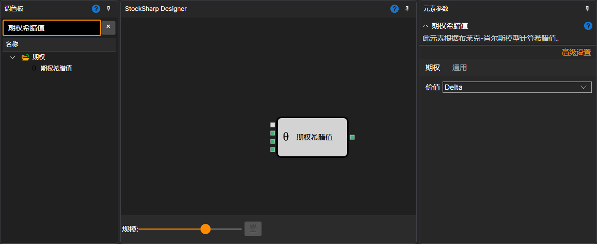

# 希腊值

该模块用于计算当前时刻的主要希腊值：Delta、Gamma、Vega、Theta 和 Rho。

### 输入端口

输入端口

- **模型** – 计算模型（例如 Black-Scholes）。
- **标的资产价格** – 标的资产的价格。
- **最大偏差** – 最大偏差。
- **权利金** – 期权价格。当 **价值** 为 IV 时，模块根据它求出隐含波动率；其他值不需要此输入。

### 输出端口

输出端口

- **结果** – 当前时刻主要希腊值（Delta、Gamma、Vega、Theta 和 Rho）的计算结果。

### 参数

参数

- **价值** – 可选择希腊值 Delta、Gamma、Vega、Theta、Rho，以及权利金（按模型计算的期权价格）和 IV（根据 **权利金** 输入计算的隐含波动率，以百分比表示），用于指定模块输出哪一个值。

## 另请参阅

[布莱克-斯科尔斯](black_scholes.md)
