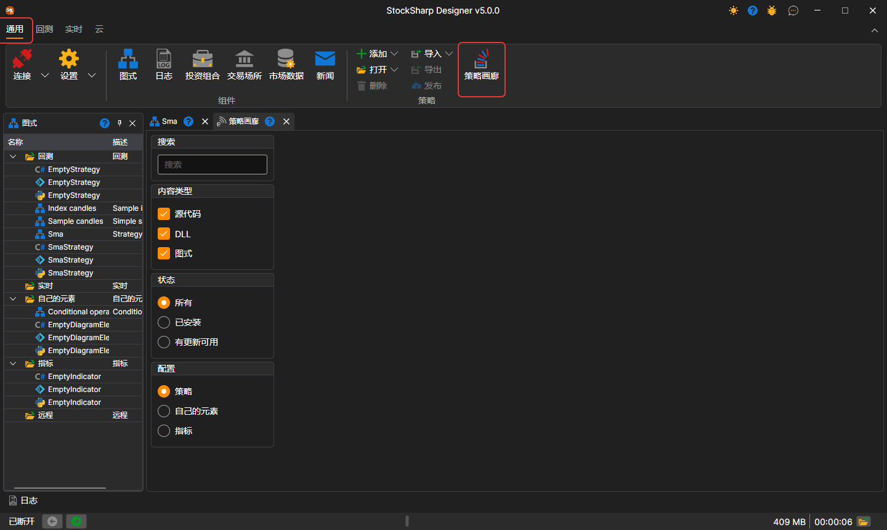

# 策略库

**策略库** 可用于将现成的交易策略下载到本地计算机。单击 **通用** 选项卡中的 **策略库** 按钮即可将其打开。

策略卡片会随着从网站读取目录而逐个显示；读取期间，面板中会显示 **正在从策略库加载策略...**。如果无法读取目录，面板会显示原因以及 **刷新** 按钮，单击该按钮可重新加载。

要将策略下载到本地计算机：

- 选择所需策略，然后单击下载按钮：

  

- 该策略将添加到 **回测** 区域的策略树中：

  

## 另请参阅

[发布自己的策略](strategy_gallery/publish_own_strategy.md)
