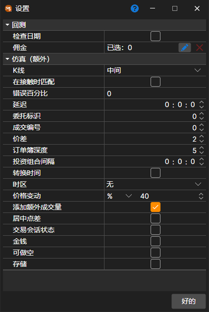

# 回测设置

打开用于历史测试或优化的策略时，可以通过功能区 **回测** 选项卡上的 **仿真器** 按钮打开仿真设置。选中某个属性后，窗口底部会显示该属性的详细说明。属性按以下分组排列：

**回测**

- **检查日期** – 检查加载的日期是否为交易日。
- **[佣金](../commissions.md)** – 佣金（经纪商佣金、交易所费用等）。

**仿真（额外）**

- **K线** – 基于K线测试时，按K线的哪个价格撮合订单：中间价、开盘价、最高价、最低价或收盘价。
- **触价撮合** – 仿真期间，当成交价格触及订单价格（即等于订单价格）时撮合订单。
- **错误百分比** – 注册新订单时产生错误的百分比。取值范围为 0（不会发生错误）到 100。
- **延迟** – 已注册订单的最小延迟值。
- **订单 ID** – 仿真器开始生成订单标识符的起始编号。
- **成交 ID** – 仿真器开始生成成交标识符的起始编号。
- **价差** – 以价格步长表示的价差大小。根据逐笔成交生成市场深度时，使用该值指定价差。
- **盘口深度** – 根据逐笔成交生成的市场深度最大档数。
- **投资组合间隔** – 投资组合重新计算的间隔。间隔为零时不执行重新计算。
- **更改时间** – 将订单和成交的时间改为交易所时间。
- **时区** – 交易所的时区。
- **价格偏移** – 相对于最近一笔成交的价格偏移，用于指定下一交易时段的最高价和最低价限制。
- **添加额外数量** – 注册大数量订单时，向市场深度添加额外数量。
- **居中点差** – 对于无法确定成交方向的价格（例如K线中的价格），将价差平均分配在价格两侧，使买入和卖出支付相同的一半价差。
- **交易会话状态** – 检查交易状态。
- **金钱** – 检查资金余额。
- **可做空** – 是否允许开立空头持仓。
- **存储** – 允许保存仿真器生成的消息。

测试时间段、交易品种、市场数据存储及其格式直接在 **回测** 选项卡上设置（参阅[用户界面](../../backtesting/user_interface.md)），策略图参数则在策略选项卡右边缘的 **策略参数** 面板中设置。

## 推荐内容

[图表](chart.md)
