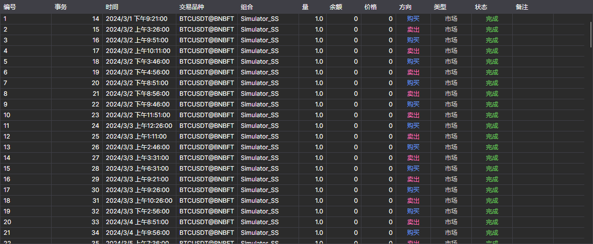

# 订单

**订单** 组件以表格形式显示策略全部订单的完整信息。

表格上方的列表用于选择显示哪些订单：**所有**、仅活动订单（**活跃**）、已成交订单（**完成**）或被拒绝的订单（**失败**）。

有关如何复制表格行、搜索和筛选行以及设置列，请参阅[使用表格](../../../terminal/user_interface/tables.md)。

## 推荐内容

[成交](trades.md)
