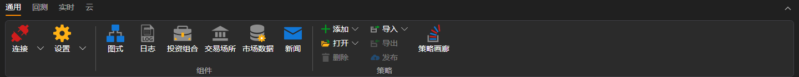
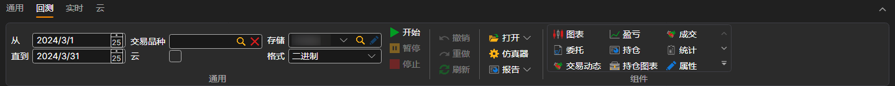
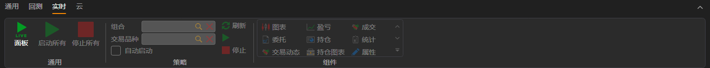
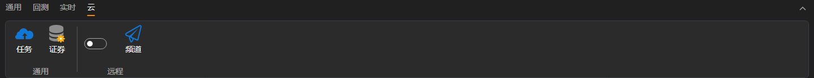

# 功能区

[Designer](../../designer.md) 的主要用户界面元素是位于应用程序窗口顶部的 **功能区**。通过功能区可以快速访问所需命令。命令按逻辑分组，并放置在不同的选项卡中。要切换到所需选项卡，只需单击其标题（名称）。每个选项卡都对应一类操作。

1. **常规** 选项卡在程序启动后默认打开，其中包含开始工作时可能需要的元素。通过 **常规** 选项卡可以打开[连接设置](../connections_settings.md)、[策略图面板](schemas.md)、[日志面板](logs.md)、[投资组合](portfolios.md)、[交易板编辑器](boards.md)和[创建历史数据存储](../market_data_storage/getting_started.md)。还可以在 **常规** 选项卡中添加、打开、删除、导入和导出策略。如果希望与社区分享策略，可以单击 *发布* 按钮。旁边的 *可用策略* 按钮用于打开自己和其他用户发布的算法。右侧提供用于打开帮助和联系我们的服务按钮。可以报告问题，也可以通过 Telegram 聊天向我们发送消息。

2. 在[策略图面板](schemas.md)中选择策略后，**回测** 选项卡会自动打开。**回测** 选项卡包含创建、调试、测试和优化策略所需的主要元素（[创建策略](../strategies/using_visual_designer.md)、[回测示例](../backtesting/getting_started.md)）。还可以在此选项卡中启动策略进行实盘交易，并选择策略所需的组件，例如图表、市场深度和成交等。

3. **实盘** 选项卡专用于实盘交易。连接配置的详细信息请参阅[连接设置](../connections_settings.md)。有关使用 [Designer](../../designer.md) 进行实盘交易的说明，请参阅[实盘交易](../live_execution/getting_started.md)。

4. **云** 选项卡。[Designer](../../designer.md) 支持使用云服务。**任务** 按钮显示已完成的 *云任务*，**交易品种** 按钮显示云端可用的交易品种。**远程** 组中的开关用于启用通过 Telegram 机器人远程控制策略（参阅[控制面板](../../telegram_services/control_panel.md)），**频道** 按钮会打开 Designer 发送消息的 Telegram 频道列表。离线模式下无法启用远程控制；如果配置文件尚未在 Telegram 机器人中激活，Designer 会提示转到机器人并打开其页面。

在 macOS 上，[Designer](../../designer.md) 的主要命令也会出现在系统菜单栏中：创建和打开策略、面板、连接、设置、编译、调试，以及包含 **关于程序** 窗口的帮助。

## 另请参阅

[工作区](workspace.md)
