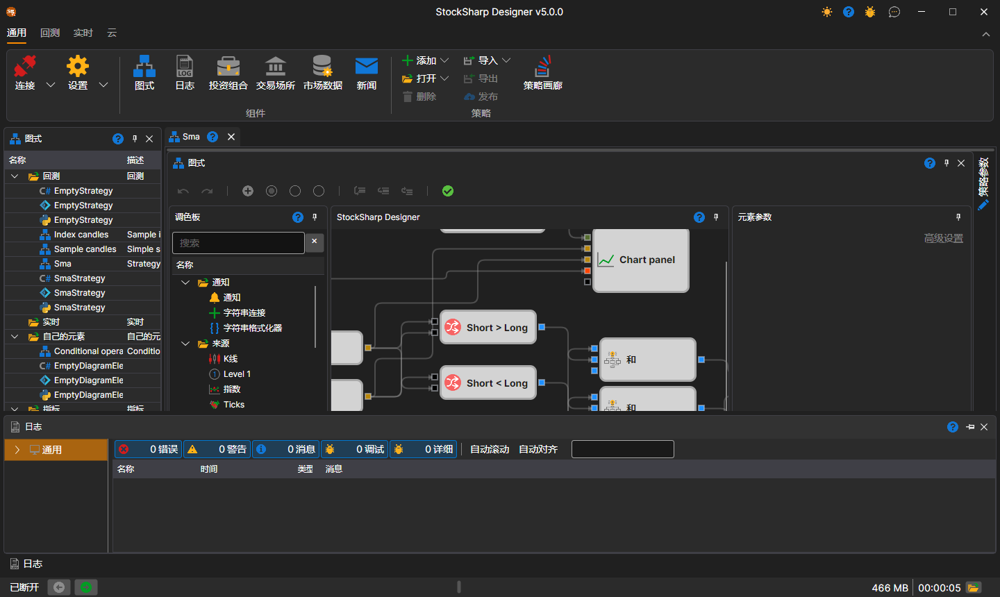

# 工作区

[Designer](../../designer.md) 中的 **工作区** 是一种支持面板停靠的窗口界面，与 Microsoft Visual Studio 使用的界面类似。用鼠标左键单击并按住面板标题，可以将面板停靠到合适的位置。拖动面板边缘可以调整其高度或宽度：

窗口底部是状态栏，显示以下内容：[Designer](../../designer.md) 是否已连接（**已断开**、**已连接** 或连接错误文本）、StockSharp 新闻、日志中警告和错误的计数、最近一条日志消息（单击它会打开[日志面板](logs.md)）、已用内存、运行时间以及日志文件夹按钮。这些部分在 Terminal 的[状态栏](../../terminal/user_interface/status_bar.md)章节中有详细说明。

## 推荐内容

[策略图面板](schemas.md)
