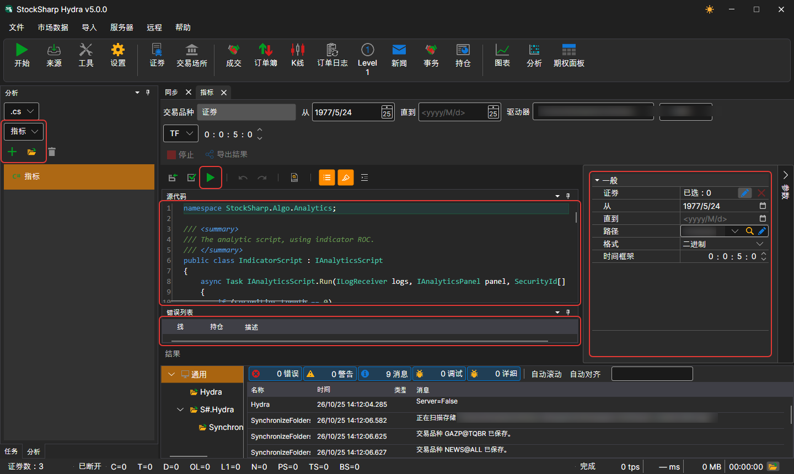
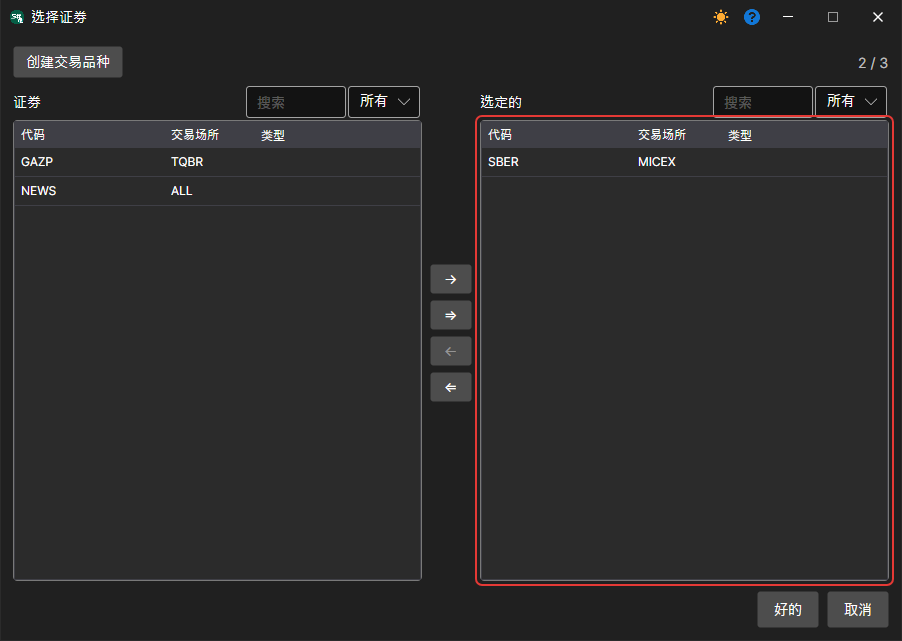

# 运行脚本

要创建新的分析脚本，请在左侧面板中打开 **分析** 选项卡，选择脚本语言和快速开始模板，然后单击 **添加**。脚本会在单独的选项卡中打开：

截图展示了该功能的主界面，其中包含以下主要组件：

- **“分析”面板**：在左侧选择新脚本的语言和模板（日内成交量、成交量分布、图表、指标以及其他分析工具）；其下方是 **添加**、**打开** 和 **删除** 图标按钮（按钮名称显示在工具提示中）以及已创建脚本的列表。
- **运行参数和按钮**：在代码上方设置交易品种、时间段、存储、格式和时间周期，并通过按钮执行 **保存源代码**、**引用**（脚本引用的程序集和包）、**编译并运行源代码**、**停止** 和 **导出结果**。
- **代码窗口**：显示所选分析脚本的源代码。用户可以直接编辑代码，以自定义或创建分析计算和策略。
- **参数面板**：位于右侧，通过 **参数** 按钮展开；用于设置分析脚本的参数，包括选择交易品种、分析时间段、数据路径及其他设置。
- **错误列表**：位于界面底部，列出编译或执行分析脚本时检测到的错误。

分析脚本采用继承自 [IAnalyticsScript](xref:StockSharp.Algo.Analytics.IAnalyticsScript) 的类形式。

设置参数时，需要指定：

- **交易品种**：根据脚本逻辑，可以选择一个或多个交易品种。

- 日期范围。
- 用于获取数据的存储。
- 脚本使用的工作时间周期（如果脚本需要）。

单击  按钮后，脚本会被编译并运行，执行结果会在新的选项卡中打开。
