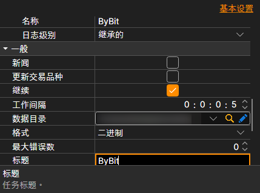

# 通用连接设置

以下连接属性适用于所有数据源。

**一般**

每个数据源自身的设置排在最前面：密钥、地址、重新连接。其后是所有数据源共有的设置：

- **新闻** — 下载新闻。
- **更新交易品种** — 建立连接时更新交易品种。
- **继续** — 从最后下载的日期继续下载。
- **工作间隔** — 工作间隔。
- **数据目录** — 数据目录，StockSharp 格式的最终文件将保存在此目录中。
- **格式** — 数据格式：BIN\/CSV。
- **最大错误数** — 任务停止前允许出现的最大错误数。默认值为 0，表示忽略错误数量。
- **标题** — 任务名称。
- **工作时间** — 任务的工作计划。
- **验证** — 如何处理未通过验证的数据：不处理、删除这些数据或停止订阅。

**远程**

- **已启用** — 远程管理任务。
- **通知** — 接收任务通知的频道。
- **日志级别** — 将任务的哪些消息发送到频道。
