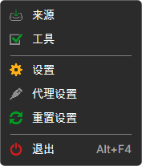
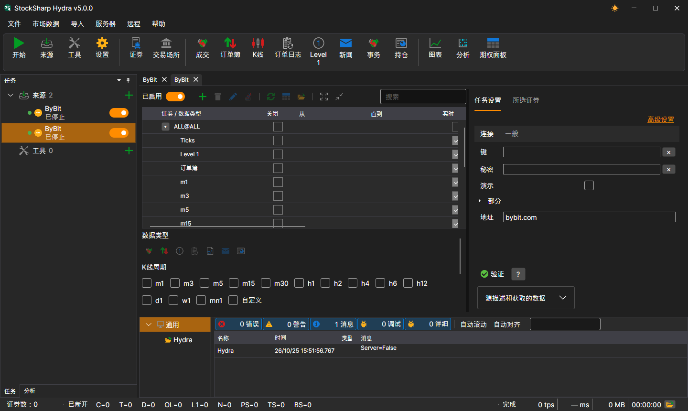
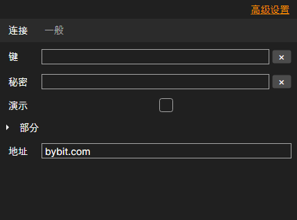

# 选择数据源

要添加新的市场数据源，请打开 **文件** 菜单并选择 **来源** 项，或单击工具栏上的 **来源** 按钮。

随后会打开数据源列表。可以一次勾选多个数据源（单击复选框或名称），然后单击 **添加所选**。

也可以添加同一数据源的多个实例，例如两个使用不同密钥或不同下载数据文件夹的 **ByBit**。每个实例都是 **任务** 面板上的一个单独任务。可以通过数据源设置中 **一般** 选项卡上的 **标题** 区分它们。

要使数据源在单击 **开始** 按钮后下载数据，必须先启用该数据源。为此可使用开关 ：**任务** 面板上的每个数据源以及数据源的交易品种表格上方（**已启用**）都有此开关。可以在添加交易品种之前或之后启用数据源。

不需要的数据源可以通过 **任务** 面板上该数据源上下文菜单中的 **删除** 命令删除。

数据源设置位于交易品种表格右侧的 **任务设置** 选项卡中。**连接** 选项卡包含数据源连接所必需的设置：密钥、地址等；**一般** 选项卡包含其余设置。**高级设置** 链接会显示数据源的全部参数，而不仅仅是基本参数。

所有数据源共有的设置，请参阅[通用连接设置](common_connection_settings.md)。

每种连接都有自己的特性。[连接器列表](../data_sources.md)中提供了连接器及其设置的列表。

**观看[视频教程](../videos/sources_samples.md)**
