# 首次启动

首次启动时，Hydra 会提示选择数据源。之后也可以通过工具栏上的 **来源** 按钮或 **文件** 菜单打开同一窗口。

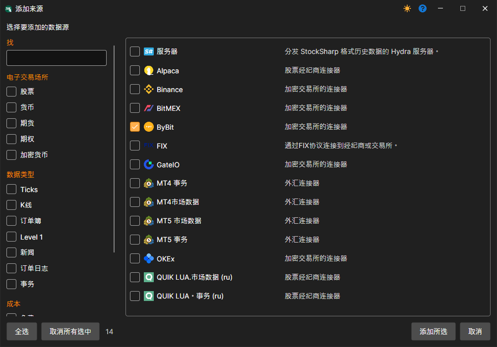

勾选所需的数据源，单击复选框或名称均可。左侧的筛选器可以缩小列表范围：交易板、数据类型、费用；**找** 字段按名称搜索。这里以勾选 **ByBit** 为例，然后单击 **添加所选**。

随后会打开一个相同的实用工具窗口。实用工具是不下载数据、而是处理已下载数据的任务：按计划导入和导出、转换、备份到云端。有关详细信息，请参阅[实用工具](tasks.md)。如果暂时不需要实用工具，请单击 **取消**。

对于每个已添加的数据源，Hydra 都会询问是否立即启用。已启用的数据源会在单击 **开始** 按钮后下载数据，已禁用的数据源则会被跳过。请回答 **是**。

数据源会显示在左侧的 **任务** 面板中，中央区域会打开其面板：交易品种表格，表格下方是所接收数据的设置，右侧是连接设置。

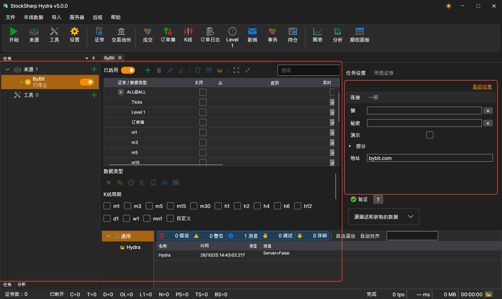

## 交易品种

> [!TIP]
> 只会下载已添加到数据源中的交易品种的数据。

刚添加数据源时，其中只有辅助交易品种 **ALL@ALL**，即“数据源的全部交易品种”。通过它可以下载数据源能够一次性为其全部交易品种提供的数据。下面以添加现货交易对 BTCUSDT 为例。

1. 单击交易品种表格上方的 **添加交易品种** 按钮 。随后会打开选择窗口：左侧是 Hydra 已知的交易品种，右侧是为该数据源选择的交易品种。

   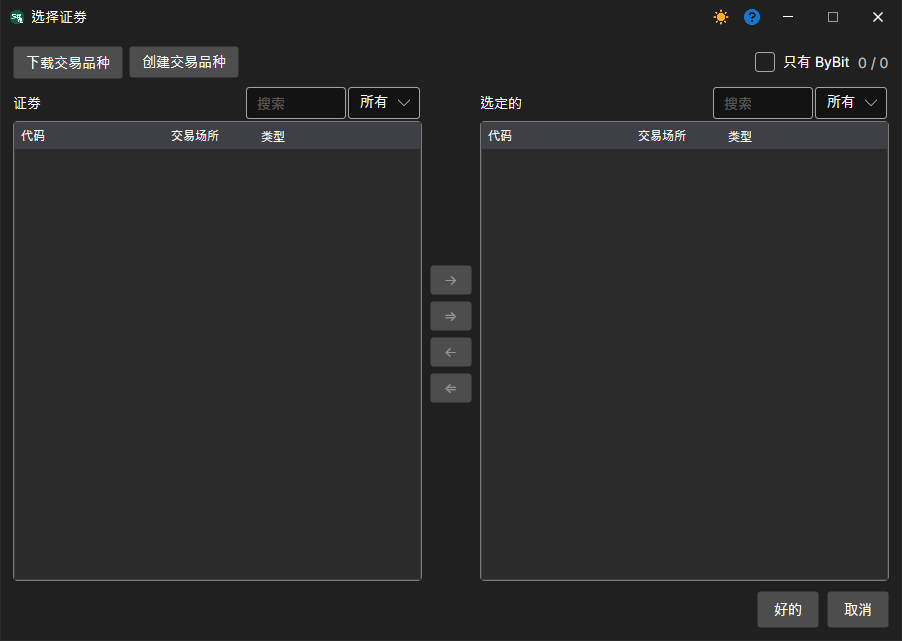

2. 第一次打开时左侧列表为空：Hydra 还不知道任何交易品种。请单击 **下载交易品种**。在打开的窗口中设置搜索条件；**所有** 复选框会向数据源请求完整列表。

   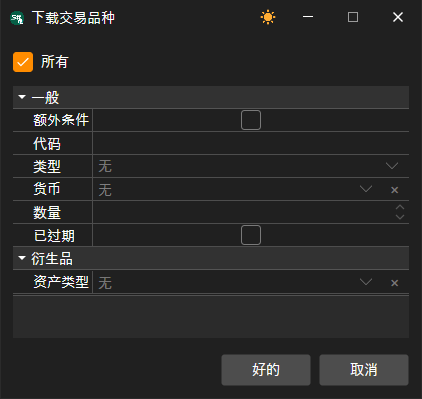

   对于部分数据源，也可以不下载完整列表，而是[指定](prepare_for_download/instruments_list.md)所需的交易品种。

3. 单击 **好的**。数据源响应后，Hydra 会报告新添加了多少个交易品种，这些交易品种会显示在左侧列表中。列表上方的计数器显示可见的交易品种数量和已知的交易品种总数；**只有 ByBit** 复选框会隐藏已由其他数据源下载的交易品种。

   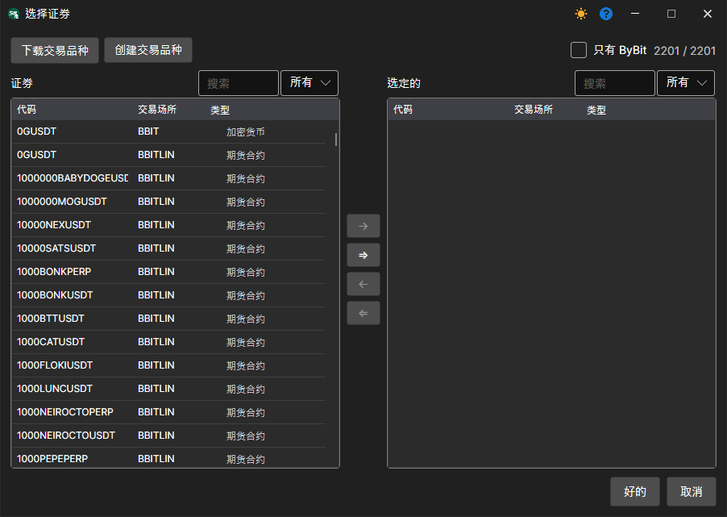

4. 在列表上方的 **搜索** 字段中开始输入交易品种代码。

   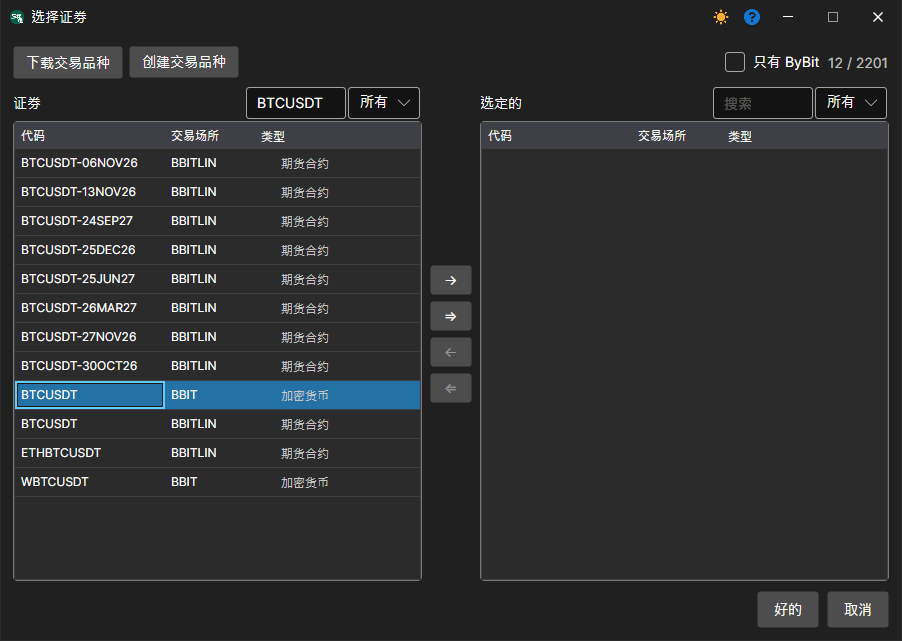

5. 双击交易品种或使用箭头按钮将其移到右侧，然后单击 **好的**。

   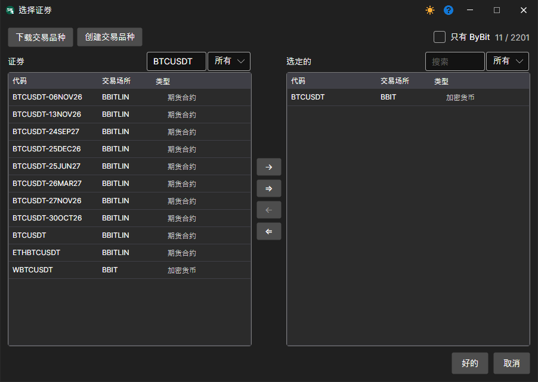

## 数据类型和时间段

选择交易品种后，Hydra 会询问要为其下载哪些数据。这里勾选 **逐笔成交** 和 5 分钟K线 **TF: 00:05:00**；每次单击都会在选择中再添加一种类型。

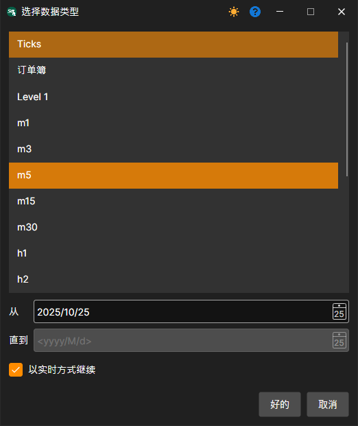

**从** 日期是历史数据的起点。勾选 **以实时方式继续** 复选框后，历史数据下载完成后数据源仍会继续接收数据，此时不需要 **至** 日期。数据源能提供多少历史数据取决于数据源本身。

单击 **好的** 后，交易品种会显示在数据源表格中。该表格为树形结构：交易品种行显示其代码，下方是所选数据类型及其开始和结束日期。

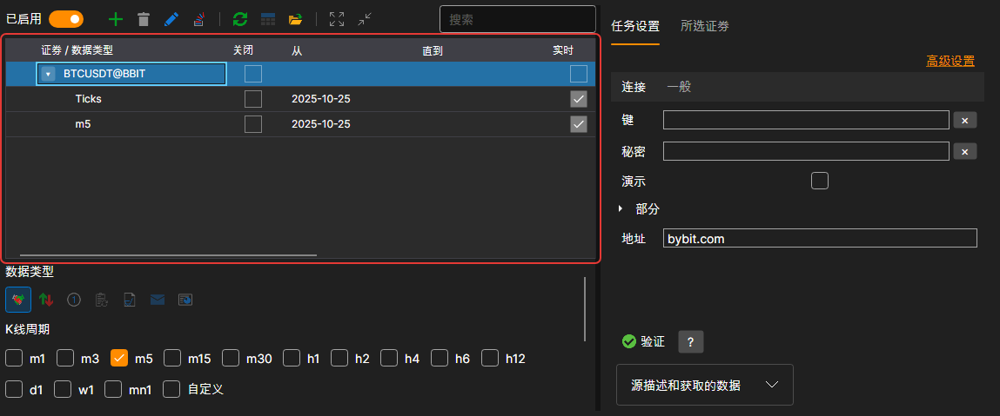

如果交易品种未选择任何数据类型，或者未设置价格步长、数量步长或小数位数，其所在行的左侧会显示 ⚠ 图标。图标上的提示会说明缺少什么。

表格下方是表格中所选行的设置。选中一行或多行后，设置会同时应用到所有选中的行：

- **数据类型** — 要接收哪些数据。可用的类型取决于数据源。

  

- **K线周期** — 要下载哪些K线。时间周期列表同样取决于数据源；**自定义** 会打开一个窗口，可在其中设置[自己的K线类型](prepare_for_download/custom_candles.md)。

  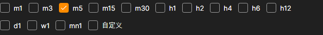

- **从** 和 **至** — 下载时间段。如果没有结束日期，数据源会下载截至今天的全部数据；如果数据源支持实时工作并且勾选了 **实时** 复选框，还会继续接收后续数据。

  **K线构建** — K线的来源：**加载** — 获取数据源提供的现成K线，**构建** — 由 Hydra 自行构建，**加载并建立** — 先加载，缺少的部分再自行构建。**生成字段** — 构建K线所用的数据：最新成交价、价差中点、最优价格等。当数据源不提供所需时间周期的K线时，自行构建K线非常方便。

  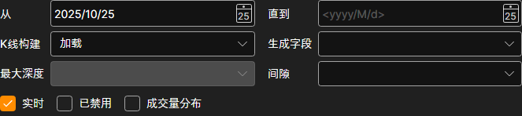

## 下载

单击工具栏上的 **开始**。数据源会建立连接并开始下载。可以在窗口底部的 **日志** 面板中查看运行过程，状态栏会统计已接收的数据：**C** — K线，**T** — 逐笔成交，依此类推。日志也会保存到 Hydra 文件夹中的文件内。

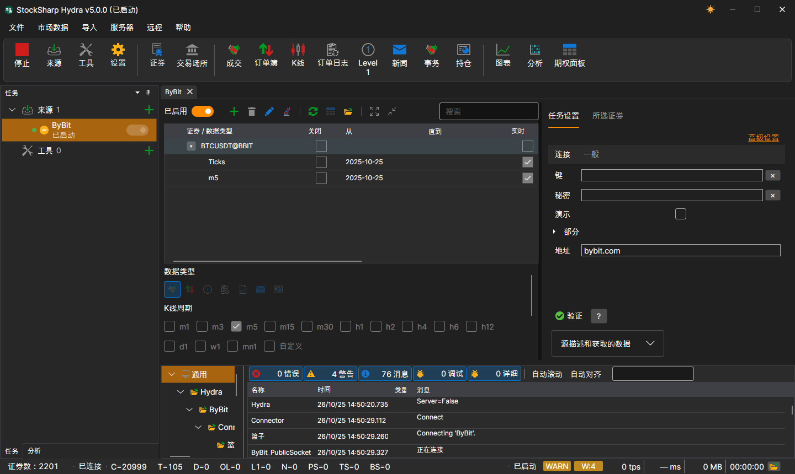

还可以添加[其他数据源](data_sources/select_source.md)。

下载的数据可以[查看](working_with_data/view_and_export.md)，可以据此[构建K线](working_with_data/candles_generation.md)，也可以[导出](working_with_data/export_data.md)为各种格式。

**观看[视频教程](videos/first_start.md)**。
