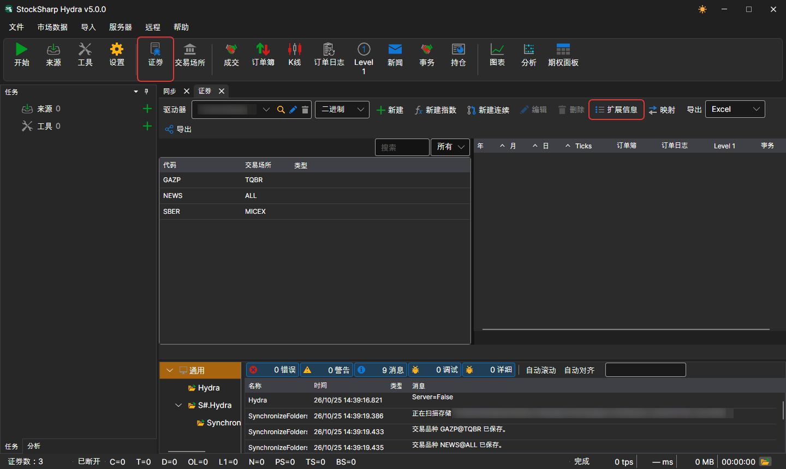
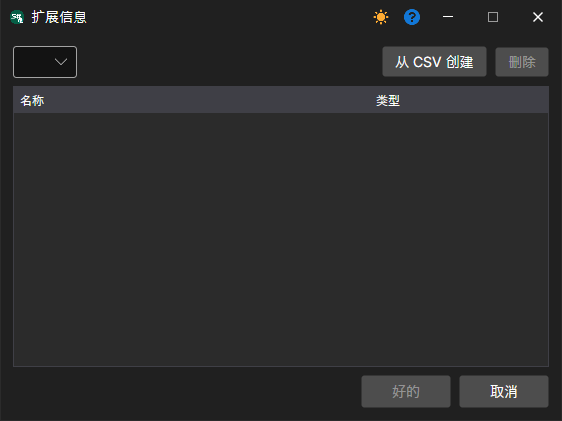

# 交易品种扩展信息

扩展信息的数据源是位于 `c:\\Users\\Users\\Documents\\StockSharp\\Hydra\\Extended info\\` 文件夹中的 **CSV** 文件。[Hydra](../../hydra.md) 启动时会自动加载这些文件。

扩展信息可以包含交易品种的任意附加资料，例如国家、城市、交易板块等。

每个扩展信息数据源（CSV 文件）都包含交易品种列表及其可用属性。不同数据源中的扩展信息各自独立。

如果数据源中没有某个交易品种的扩展信息，则交易品种列表中的对应列将为空。

要选择所需的扩展信息，请执行以下操作：

1. 在 **交易品种** 面板上单击 **扩展信息** 按钮。
2. 在随后显示的窗口中，选择所需 CSV 文件的路径。

下面是扩展信息 **CSV** 文件的示例。各值以分号分隔：第一行是属性名称，第二行是属性类型，之后每一行是交易品种标识符及其属性值：

```
SecurityId;Country;City;Site
string;string;string;string
SBER@TQBR;俄罗斯;莫斯科;www.sberbank.ru
GAZP@TQBR;俄罗斯;圣彼得堡;www.gazprom.ru
```
