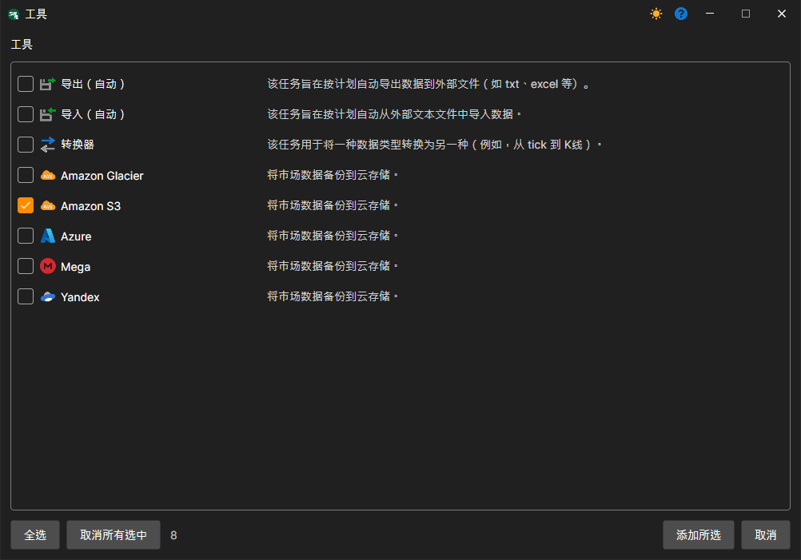
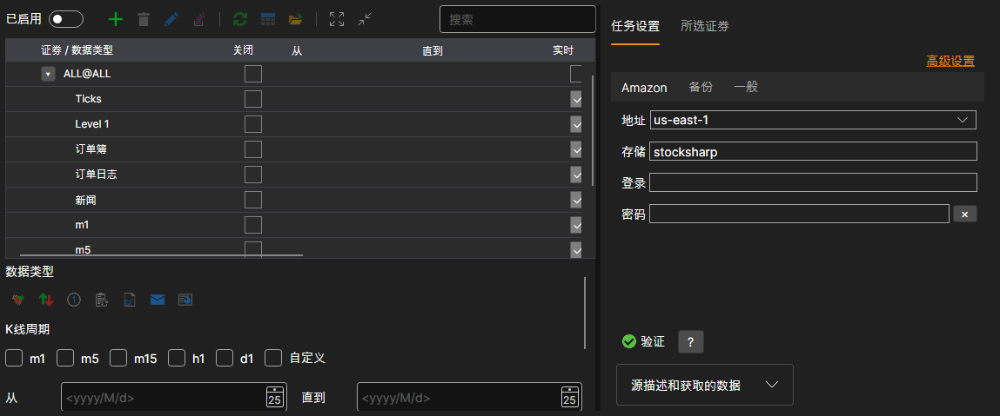

# Hydra 设置

下面介绍如何创建和配置备份任务。

1. 要创建任务，请单击 **工具** 按钮，在打开的窗口中勾选 **Amazon S3**，然后单击 **添加所选**。询问是否立即启用任务时，可以回答 **否**：配置完成后再通过开关启用任务。
2. 接下来配置任务。设置按选项卡分组，**高级设置** 链接会在一个列表中显示全部设置。

   **Amazon**
   - **地址** — Bucket 设置中指定的区域。请参阅 [区域和端点](https://docs.aws.amazon.com/general/latest/gr/rande.html#s3_region)。
   - **存储** — Bucket 名称。
   - **登录** — 访问密钥 **Access Key ID**。
   - **密码** — 访问密钥 **Secret Access Key**。

   **备份**
   - **文件夹** — 上传数据的云端文件夹。如果未指定，数据会上传到 Bucket 的根目录。
   - **时间偏移** — 相对于当前日期的偏移天数，用于避免复制尚未结束的交易时段的数据。
   - **错误** — 失败的操作（创建文件夹、上传文件）在任务报告错误之前重试的次数。

   **常规**
   - **继续** — 从最后复制的日期继续复制。
   - **操作间隔** — 任务的运行间隔。
   - **数据目录** — 用于读取待转换数据的数据目录。
   - **格式** — 转换后的数据格式：BIN\/CSV。
   - **最大错误数** — 任务停止前允许出现的最大错误数。默认值为 0，表示忽略错误数量。
   - **标题** — 任务标题。
   - **工作时间** — 任务的工作计划。勾选该字段后，**...** 按钮变为可用，单击它会打开计划编辑器。

   **日志**
   - **日志级别** — 日志记录级别。
3. 配置任务后，添加需要保存到备份存储中的交易品种，然后单击 **开始** 按钮。

## 推荐内容

[创建和配置账户](setup.md)
