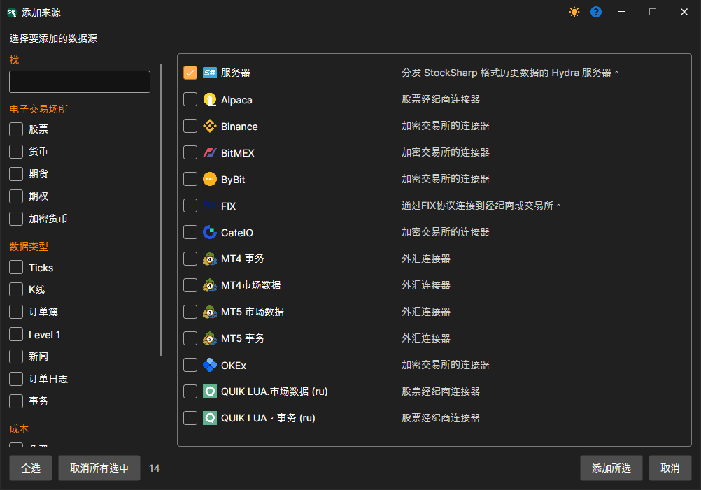
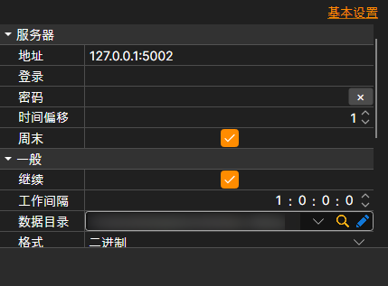

# 连接 Hydra 客户端

在服务器模式下，可以连接另一个作为客户端运行的 Hydra 程序，由该客户端将数据下载到本地。与[通过 FIX 协议连接](fix_fast_connectivity.md)不同，数据会以 StockSharp 格式的文件传输。因此，该数据源适合传输大量历史数据。

连接时使用 **服务器** 数据源：在 **来源** 部分旁的 **+** 按钮打开的窗口中勾选该数据源，然后单击 **添加所选**。

**设置**

**服务器**

- **地址** - Hydra 服务器地址。
- **登录名** - 登录名（服务器要求身份验证时必填）。
- **密码** - 密码（服务器要求身份验证时必填）。
- **时间偏移** - 相对于当前日期的天数偏移，用于避免下载当前交易时段尚未完成的数据。
- **周末** - 是否跳过周末。

**主要**

- **继续** - 从最后下载的日期继续下载。
- **运行间隔** - 运行间隔。
- **数据目录** - 数据目录，最终生成的 [S#](../../api.md) 格式文件将保存在此处。
- **格式** - 数据格式：BIN 或 CSV。
- **最大错误数** - 允许的最大错误数。达到该数量后，任务将停止。默认值为 0，表示忽略错误数量。
- **标题** - 任务名称。
- **工作时间** - 任务的工作计划。
- **验证** - 如何处理未通过验证的数据：不处理、删除这些数据或停止订阅。

**远程**

- **已启用** - 远程管理任务。
- **通知** - 接收任务通知的频道。
- **日志级别** - 将任务的哪些消息发送到频道。

**日志**

- **日志级别** - 日志级别。
