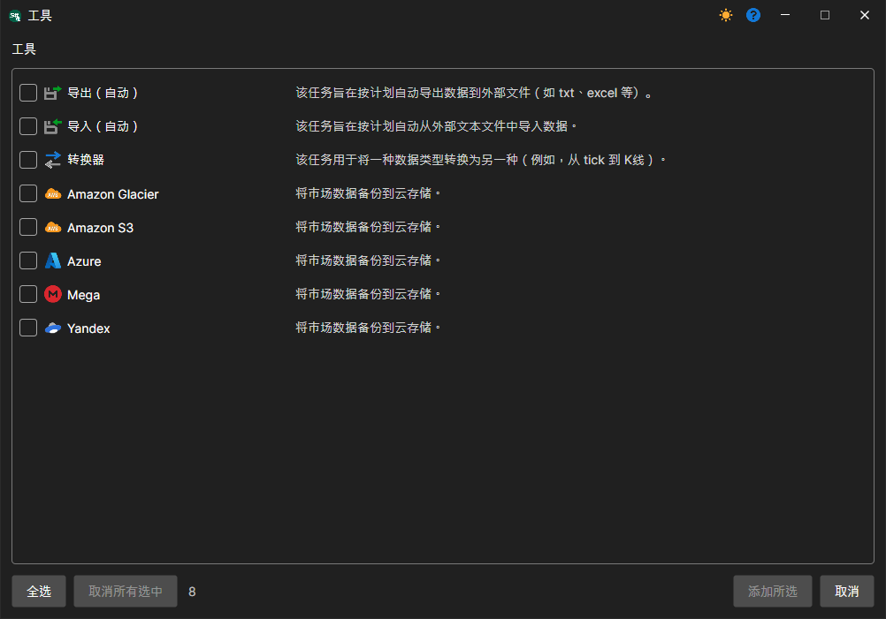

# 任务

实用工具是在指定时间重复执行的操作。

实用工具位于左侧 **任务** 面板的 **工具** 组中（参阅[用户界面](user_interface.md)）。实用工具的操作方式与数据源相同：可以添加、删除、编辑、启用或禁用。要添加实用工具，请在 **文件** 菜单中选择 **工具** 项。随后会出现相应窗口，可以在其中选择所需的 **工具**。

目前，[Hydra](../hydra.md) 中提供四类任务：

- [自动导入](tasks/import_auto.md) — 从 CSV 格式导入数据。
- [转换器](tasks/converter.md) — 将交易所数据转换为逐笔成交、K线或订单簿。
- [自动导出](tasks/export_auto.md) — 将K线导出为不同格式。
- [备份](misc/backup.md) — 将数据备份到云服务。
