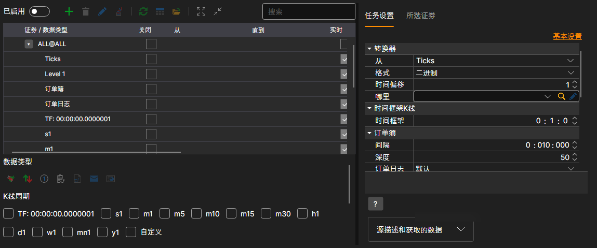
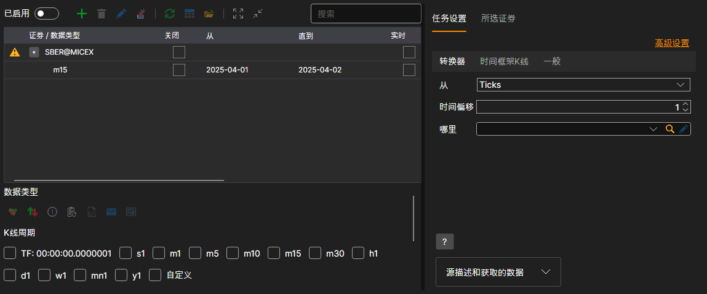
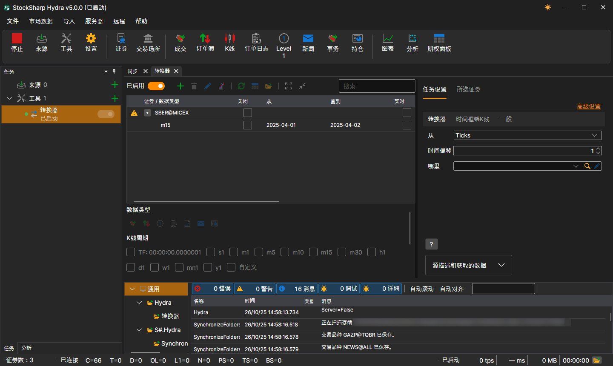
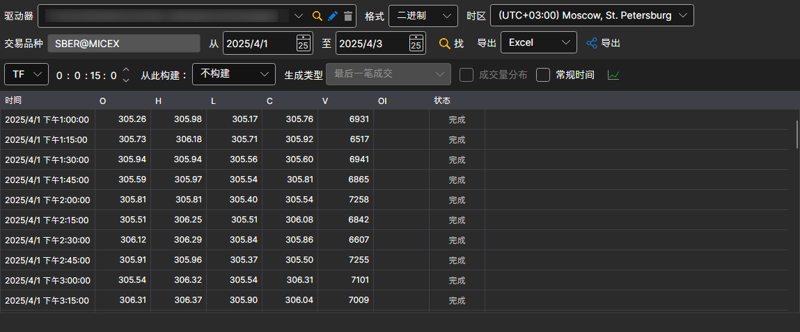

# 转换器

该任务用于转换交易所数据，例如将订单日志转换为逐笔成交，或将逐笔成交转换为K线等。

该任务通过 **工具** 按钮添加：在打开的窗口中勾选 **转换器**，然后单击 **添加所选**。任务设置按选项卡分组，**高级设置** 链接会在一个列表中显示全部设置。

**转换器**

- **来源** — 要转换的源数据类型。
- **格式** — 转换后的数据格式：BIN\/CSV。
- **时间偏移** — 相对于任务启动日期的偏移天数，用于避免转换不完整交易日的数据。如果配置了实时数据转换，受更新间隔影响，当前交易日的数据可能尚未完整。设置时间偏移可以避免转换此类不完整数据。
- **保存位置** — 保存转换后数据的数据目录。

**时间框架K线**

- **时间框架** — 在 **来源** 字段中选择K线时，用作转换源的K线的时间周期。

**订单簿**

- **间隔** — 订单簿生成间隔。
- **深度** — 生成订单簿时的最大深度。
- **订单日志** — 从订单日志构建订单簿的方式。

  **默认** 适用于大多数情况。如果连接有自己的订单日志格式（例如莫斯科交易所的 **Plaza**），则在连接建立后，该格式会出现在列表中。

**常规**

- **继续** — 从最后转换的日期继续转换。
- **操作间隔** — 任务的运行间隔。
- **数据目录** — 用于接收待转换数据的数据目录。
- **格式** — 待转换数据的格式：BIN\/CSV。
- **最大错误数** — 任务停止前允许出现的最大错误数。默认值为 0，表示忽略错误数量。
- **标题** — 转换器。
- **工作时间** — 任务的工作计划。

**日志**

- **日志级别** — 日志记录级别。

下面以一个数据转换示例说明操作过程。

1. 打开 **转换器** 任务，然后单击表格上方的 **+** 按钮添加交易品种。
2. 在打开的窗口中设置转换后需要得到的数据类型和时间段。用于转换的源数据类型在 **来源** 设置中指定。例如，将逐笔成交转换为 15 分钟时间周期的K线。

   > [!TIP]
   > **重要！**要生成的数据时间范围必须与可供转换的数据时间范围相对应，否则数据无法转换。还必须在设置中正确指定源数据格式，使其与实际待转换数据的格式一致。
3. 指定所需目录、时间偏移和运行间隔。
4. 通过 **已启用** 开关启用任务，然后单击 **开始** 按钮启动转换。

转换完成后，可以[查看](../working_with_data/view_and_export.md)生成的数据。

此功能与通过其他数据类型[生成所需市场数据](../working_with_data/any_market_data_types.md)类似。

**观看[视频教程](../videos/converter_task.md)**
