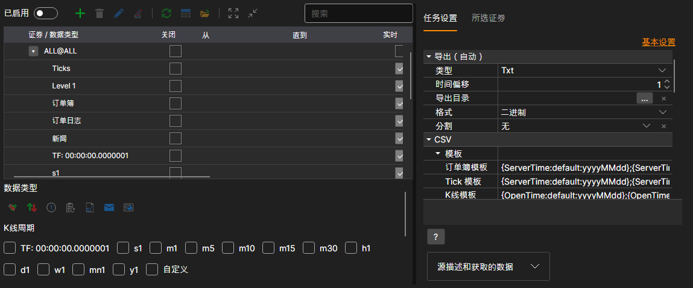
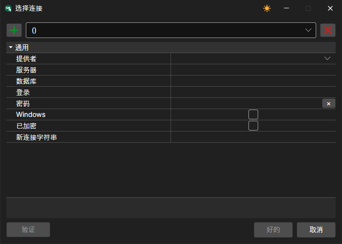
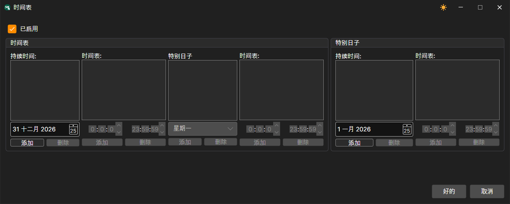
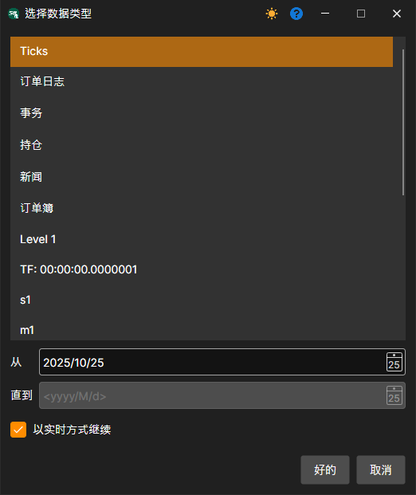
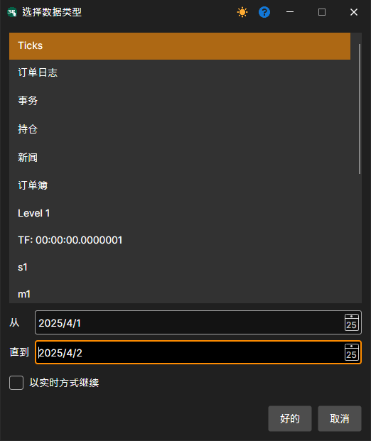
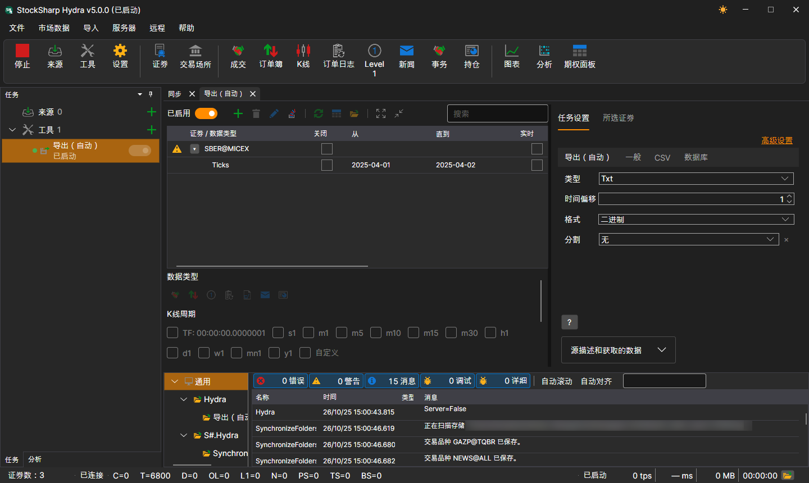

# 自动导出

该任务用于将交易所数据导出为 Excel、xml、sql、bin、Json 或 txt 等格式。

该任务通过 **工具** 按钮添加：在打开的窗口中勾选 **导出（自动）**，然后单击 **添加所选**。任务设置按选项卡分组，**高级设置** 链接会在一个列表中显示全部设置。



**导出（自动）**

- **类型** — 导出类型（格式）。
- **时间偏移** — 以天为单位的时间偏移。
- **导出目录** — 数据导出目录。如果未指定，文件会保存到数据目录中。
- **格式** — 数据格式。
- **拆分** — 拆分类型：按日、按月或按年。

**数据库**

- **连接** — 数据库连接，用于通过 SQL 导出。
- **数据包** — 传输数据包的大小，默认值为 50 个元素，用于通过 SQL 导出。
- **唯一性** — 检查数据库中数据的唯一性。该选项会影响性能，默认启用，用于通过 SQL 导出。

> [!TIP]
> 使用 SQL 导出时，需要设置数据库连接。

单击 **连接** 字段中的放大镜按钮可打开连接窗口，窗口中的 **+** 按钮用于添加新连接：



- **提供程序** — 数据库提供程序设置。
- **服务器** — 服务器地址或数据库路径。
- **数据库** — 数据库名称。SQLite 不使用此参数。
- **登录名** — 访问数据库的登录名。匿名访问不使用此参数。
- **密码** — 访问数据库的密码。匿名访问不使用此参数。
- **Windows** — 使用当前 Windows 账户连接数据库。
- **已加密** — 加密与服务器之间的连接。
- **新连接字符串** — 完整的连接字符串。

> [!TIP]
> 可以使用 **检查** 按钮检查数据库连接。

**CSV**

- **模板** — 各种导出数据类型使用的模板。
- **标题** — 文件第一行中的标题。如果传入空字符串，则不会向文件添加标题。
- **文件名格式** — 导出文件名的记录格式。

**常规**

- **继续** — 从最后导出的日期继续导出。
- **操作间隔** — 任务的运行间隔。
- **数据目录** — 待导出数据所在的数据目录。
- **格式** — 转换后的数据格式：BIN\/CSV。
- **最大错误数** — 任务停止前允许出现的最大错误数。默认值为 0，表示忽略错误数量。
- **标题** — 任务标题。
- **工作时间** — 任务的工作计划。

**日志**

- **日志级别** — 日志记录级别。

下面以自动导出为例说明操作过程：

1. 通过表格上方的 **+** 按钮选择交易品种。
2. 配置需要导出的市场数据。
3. 设置导出时间范围。如果已经配置实时下载市场数据，可以不指定结束日期。在这种情况下，数据会按照运行间隔（数据更新间隔）实时导出。
4. 配置目录、运行间隔、数据类型和数据格式。
5. 通过 **已启用** 开关启用任务，然后单击 **开始** 按钮启动导出。

查看导出的数据。按默认逐笔成交模板导出为 **Txt** 类型的 SBER@MICEX 4 月 1 日和 2 日逐笔成交数据保存在 `trades_SBER@MICEX_2025_04_01_2025_04_02.csv` 文件中，其开头如下：

```
20250401;10:00:00.000000;15500000;305.26;88;Buy
20250401;10:00:09.000000;15500001;305.23;2;Sell
20250401;10:00:18.000000;15500002;305.20;48;Sell
20250401;10:00:27.000000;15500003;305.22;46;Buy
20250401;10:00:36.000000;15500004;305.28;105;Sell
```

**观看[视频教程](../videos/export_task.md)**
