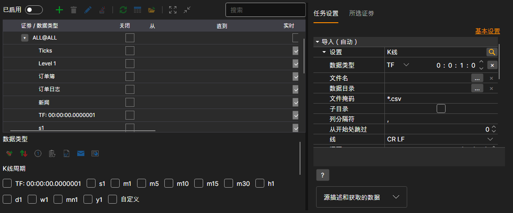
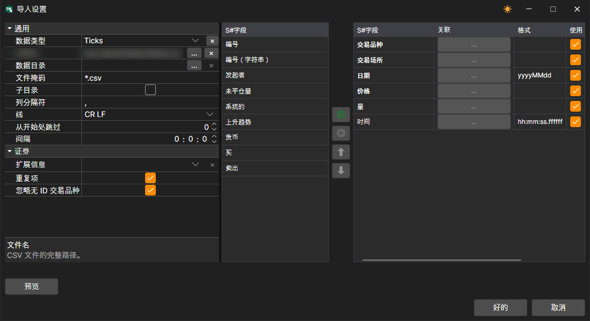
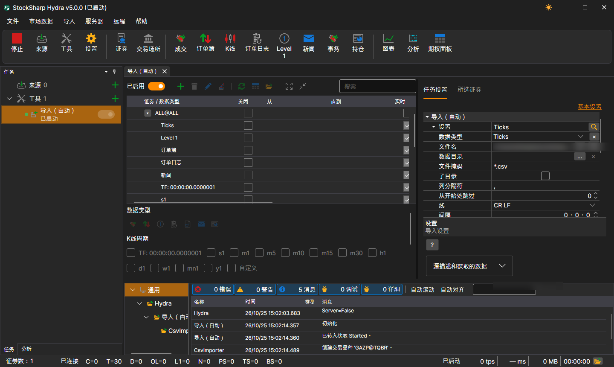

# 自动导入

该任务会按照指定的文件掩码，自动从指定目录中的文件导入交易所数据。

该任务通过 **工具** 按钮添加：在打开的窗口中勾选 **导入（自动）**，然后单击 **添加所选**。**高级设置** 链接会在一个列表中显示任务的全部设置。

导入的内容和来源在 **设置** 行中指定。单击该行中的放大镜按钮会打开一个窗口，除了相同的设置外，还可以在其中将文件列映射到 S# 字段，方式与[导入](../importing.md)选项卡中相同：

**设置**

- **数据类型** — 导入的数据类型。
- **文件名** — 文件的完整路径。
- **数据目录** — 如果导入的不是单个文件，而是目录中所有匹配的文件，则为这些文件所在的目录。
- **文件掩码** — 扫描目录时使用的文件掩码，例如 `candles\*.csv`。
- **子目录** — 是否包含子目录。
- **列分隔符** — 列分隔符。制表符使用 TAB 表示。
- **线** — 文件中的行尾：CR LF、LF 或 CR。
- **从开始处跳过** — 从文件开头跳过的行数，用于忽略包含元信息的行。
- **间隔** — 数据更新频率。
- **扩展信息** — 将导入的扩展字段保存到扩展信息存储中。
- **重复项** — 如果重复的交易品种已存在，是否对其进行更新。
- **忽略无 ID 项** — 忽略没有标识符的交易品种。

**常规**

- **继续** — 从最后导入的日期继续导入。
- **操作间隔** — 任务的运行间隔。
- **数据目录** — 用于接收待转换数据的数据目录。
- **格式** — 转换后的数据格式：BIN\/CSV。
- **最大错误数** — 任务停止前允许出现的最大错误数。默认值为 0，表示忽略错误数量。
- **标题** — 任务标题。
- **工作时间** — 任务的工作计划。

**日志**

- **日志级别** — 日志记录级别。

下面以自动导入逐笔成交为例。在 `ticks.csv` 文件中，每笔成交记录为一行，格式为 `GAZP,TQBR,20250401,128.58,74,10:00:02.000000`：交易品种、交易板块、日期、价格、数量和时间。

1. 单击 **设置** 行中的放大镜按钮，打开导入设置窗口。
2. 选择数据类型 **逐笔成交**，并在 **文件名** 字段中指定文件路径。
3. 在 S# 字段中添加 **时间** 字段：必填字段（交易品种、交易板块、日期、价格和数量）已经按照文件中各列的顺序排列，时间字段添加在它们之后。单击 **好的**。
4. 通过 **已启用** 开关启用任务，然后单击 **开始** 按钮启动导入。
