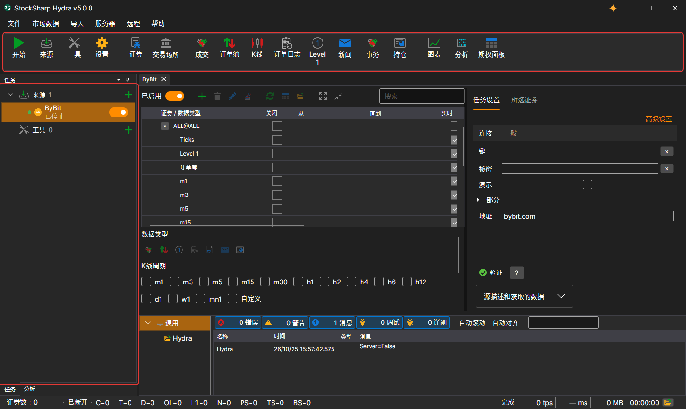
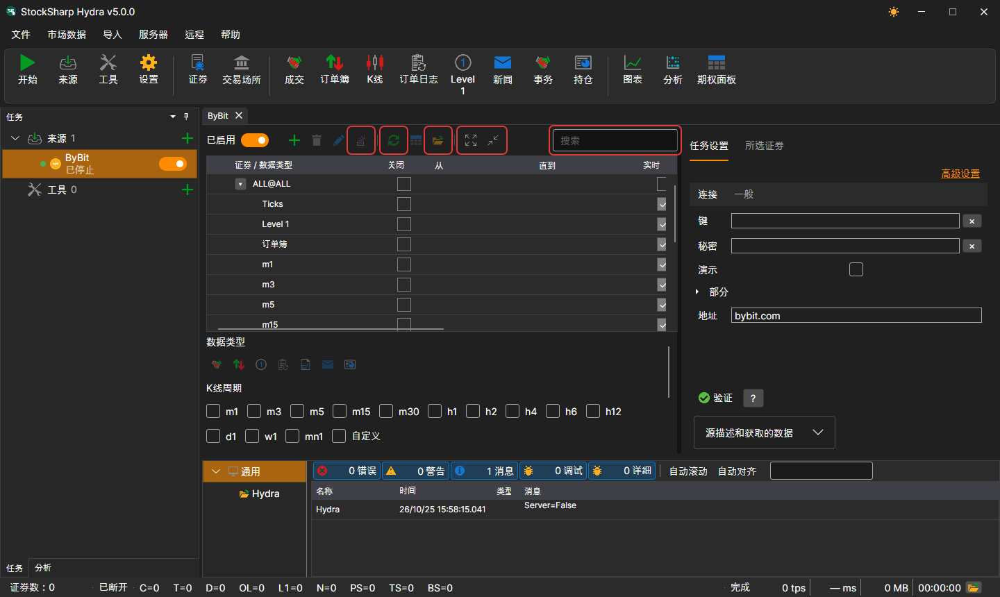

# 用户界面

[Hydra](../hydra.md) 窗口由菜单、菜单下方的命令面板、左侧的 **任务** 和 **分析** 面板、底部的 **日志** 面板以及中央的文档组成：数据源面板、实用工具面板和市场数据面板。窗口底部是状态栏。

## 菜单

- **文件** — 添加[数据源](data_sources.md)和实用工具、[通用设置](misc/settings.md)、[代理设置](misc/network_settings.md)、[重置设置](misc/settings_reset.md)以及退出。
- **市场数据** — 用于查看存储中市场数据的面板：交易品种、交易场所、成交、订单簿、K线、订单日志、Level 1、新闻、事务、持仓，以及[图表](working_with_data/chart.md)、分析和期权面板。
- **导入** — 从文件[导入](importing.md)数据、存储[同步](misc/synchronization.md)以及构建存储索引。
- **服务器** — [服务器模式](server_mode/settings.md)：启用、网络设置、用户以及客户端订阅。
- **远程** — 通过 Telegram 机器人远程控制 Hydra（参阅[控制面板](../telegram_services/control_panel.md)），以及 **频道** 窗口，其中列出 Hydra 发送消息的 Telegram 频道。
- **帮助** — 更改界面主题、联系 StockSharp 团队、报告问题、文档以及 **关于程序** 窗口。

在 macOS 上，菜单会移到系统菜单栏中。

## 命令面板

菜单下方是包含最常用操作的命令面板：**启动 / 停止所有任务**、添加数据源和实用工具、设置；**交易品种** 和 **交易场所** 面板；市场数据面板，即成交、订单簿、K线、订单日志、Level 1、新闻、事务和持仓；以及 **图表**、**分析** 和 **期权面板**。

## 任务

左侧 **任务** 面板中的任务分为 **来源** 和 **工具** 两组。每组都会显示任务数量和用于添加新任务的 **+** 按钮。每个任务都显示一个圆点（任务启用时为绿色）、图标、名称、显示当前状态的一行文字以及开关；时钟图标表示该任务设置了工作时间。双击会打开任务面板，右键单击会打开包含 **打开** 和 **删除** 项的菜单。

当窗口中央尚未打开任何内容时，会显示欢迎界面，其中有 **添加来源** 和 **添加工具** 按钮。

执行耗时较长的操作时（例如读取大型存储或添加数据源），窗口会被半透明遮罩覆盖，遮罩上会说明当前正在执行的操作。

## 任务面板

数据源的交易品种表格上方有：搜索框、**已启用** 开关、添加、删除和修改交易品种的按钮、**添加 ALL@**（一次性添加数据源的全部交易品种）、日期同步、转到数据和存储文件夹，以及折叠和展开行的按钮。设置选项卡上有检查连接的按钮和数据源说明，**所选交易品种** 选项卡则显示表格中所选交易品种的属性。

## 状态栏

窗口底部显示：存储中有多少交易品种、Hydra 是否已连接、启动以来每种数据各接收了多少、程序当前正在执行什么操作，以及日志中最近一条警告或错误。带文件夹图标的按钮会打开日志文件夹。执行耗时较长的操作时（读取大型存储、添加数据源），窗口会被遮罩覆盖，遮罩上会说明正在执行的操作。

## 另请参阅

[首次启动](first_start.md)

[数据源](data_sources.md)
