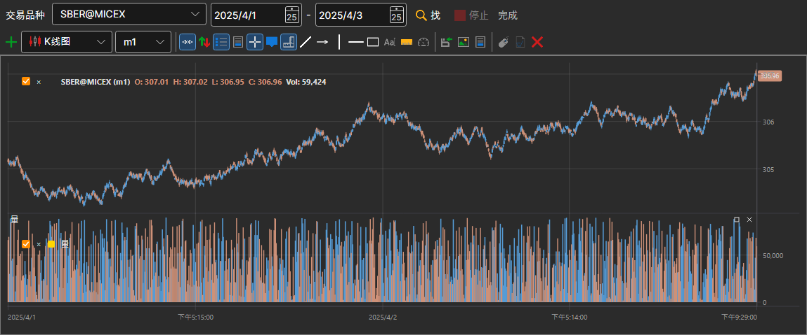

# 图表

**图表** 面板可以显示存储中任意交易品种的K线。可以通过 **市场数据 → 图表** 菜单项或命令面板上的 **图表** 按钮打开该面板。

在图表上方的一行中选择 **交易品种** 和时间段（开始日期和结束日期），然后单击 **找**。K线从存储中读取，并在读取的同时绘制；**停止** 会中断读取，按钮旁的文字显示工作进度。

下方是一个功能完整的图表，与 [Terminal](../../terminal/user_interface/components/chart.md) 中的图表相同：包含工具栏、K线样式、指标和绘图工具。可以向图表添加[指标](view_and_export/indicators.md)，**停止绘制** 按钮用于停止长时间段的耗时绘制。

## 另请参阅

[生成K线](candles_generation.md)

[查看和导出](view_and_export.md)
