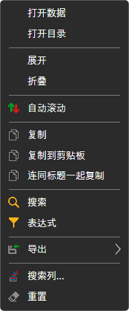
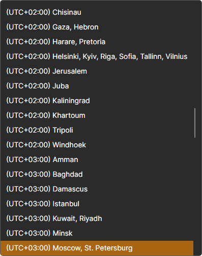
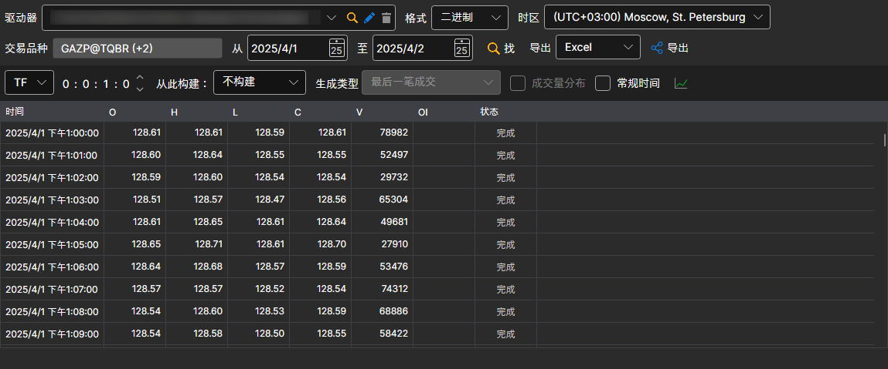
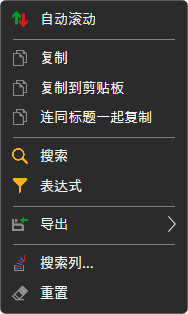

# 查看和导出

可以在专用面板中查看 [Hydra](../../hydra.md) 接收到的数据。

为此，请在 **市场数据** 菜单中选择以下任一项：[逐笔成交](view_and_export/ticks.md)、[订单簿](view_and_export/order_books.md)、[生成K线](candles_generation.md)、[订单日志](view_and_export/order_log.md)、[Level 1](view_and_export/level_1_.md)、[新闻](view_and_export/news.md)、[交易事务](view_and_export/transactions.md)、[期权面板](view_and_export/option_desk.md)、[指标](view_and_export/indicators.md)、[持仓](view_and_export/positions.md)。

也可以从任务的交易品种表格中打开包含其数据的面板：双击数据类型，或选择上下文菜单中的 **打开数据** 项，如图所示。

每个面板都包含以下通用设置界面：

- 顶部一行显示市场数据存储（**驱动器**）、数据 **格式**（二进制或 CSV）以及显示时间所用的 **时区**。
- 第二行用于选择交易品种和请求数据的时间范围。单击 **选择交易品种** 按钮后，会出现交易品种选择窗口，可以选择一个或多个交易品种。如果选择多个交易品种，之后导出到 Excel 或 CSV 时，程序会自动将不同交易品种的数据分别保存到不同文件。
- 找到的数据按每批一千行加载到表格中：表格滚动到末尾时会自动加载下一批，因此可以随意向后翻看，无需等待整个时间段加载完毕。按列排序只会对已加载的行排序，而通过面板按钮导出时会写入所选时间段的全部数据，而不仅仅是已加载的数据。
- 如果数据来自时区与当前时区不同的数据源，可以调整时区。构建完成后，数据会按用户选择的时区显示。
- 部分数据源无法提供某些数据，因此程序提供了[构建来源](any_market_data_types.md)字段。借助该字段，用户可以使用另一种市场数据来构建所需市场数据。也可以在不额外下载数据的情况下，以现有数据为基础构建市场数据。
- 设置上述参数后，单击 **找** 按钮 。 搜索或导出期间，设置行下方会显示进度以及 **停止** 按钮。导出完成后，同一位置会出现 **显示文件** 或 **打开目录** 按钮，用于打开导出结果。

数据值表格的上下文菜单可用于：启用自动滚动、将所选行复制到剪贴板、查找值、使用表达式筛选行、将表格导出到文件、剪贴板或打印、选择要显示的列以及重置列布局。

