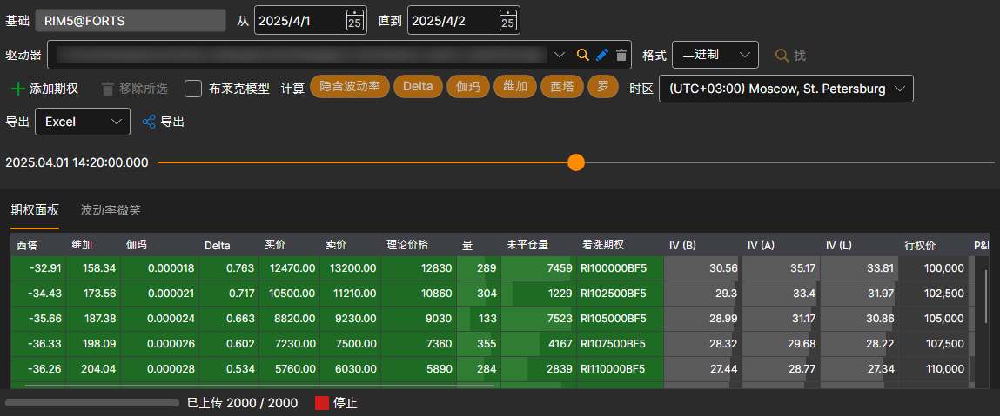
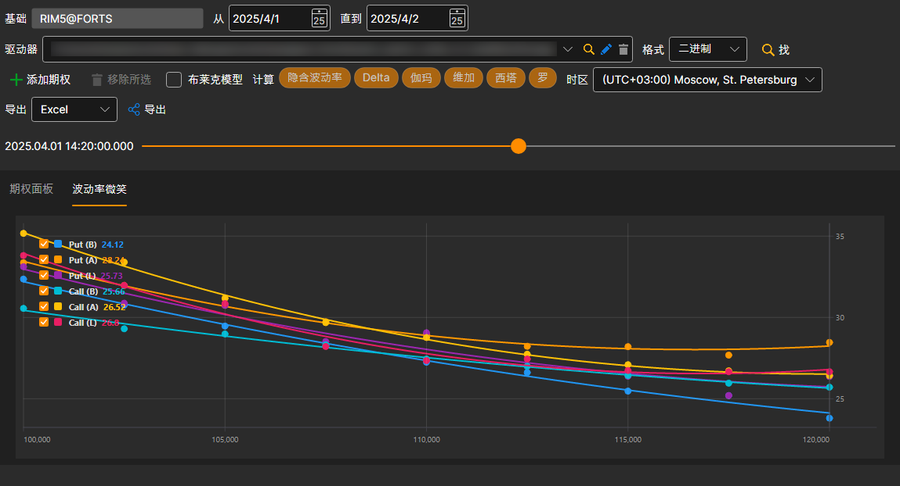

# 期权面板

在打开的窗口中选择标的资产：该标的资产的期权会自动添加到面板中，时间范围会自动设置为存储中有数据的时间段。可以通过 **添加期权** 按钮添加其他期权，通过 **移除所选** 按钮删除多余的期权。然后单击  按钮：

如果没有希腊字母指标的历史数据，但有价差数据，可以计算主要的希腊字母指标，包括 Delta、Gamma、Vega、Theta、Rho 和隐含波动率：为此，请在 **计算** 字段中勾选这些指标。波动率根据买价、卖价和最新成交价计算，其他希腊字母指标则根据价差中点的波动率计算。

面板上方的滑块可以将面板切换到已加载历史中的任意时刻；滑块左侧显示该时刻的时间。当滑块移到最后一个已加载的时刻时，会加载下一部分历史数据。

要查看**波动率微笑**，请打开 **波动率微笑** 选项卡。

找到的数据可以[导出为所需格式](../export_data.md)。
