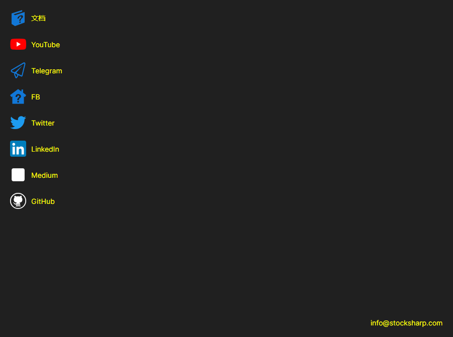

# 帮助

**帮助** 页面可以通过[安装程序](../installer.md)窗口顶部的同名选项卡打开。

该页面汇集了用户最常从[安装程序](../installer.md)访问的链接：**文档**、**YouTube**、**Telegram**（支持聊天）、**Twitter**、**Dzen** 和 **GitHub**。链接会在系统默认浏览器中打开。页面底部是可用于联系公司的电子邮件地址。

可以通过窗口标题栏中的按钮报告问题，该按钮在任何页面上都可用。如果[安装程序](../installer.md)的行为与预期不符，请在报告中附上[日志](logs.md)页面中的记录，从中可以看出具体发生了什么。

## 推荐内容

[日志](logs.md)
