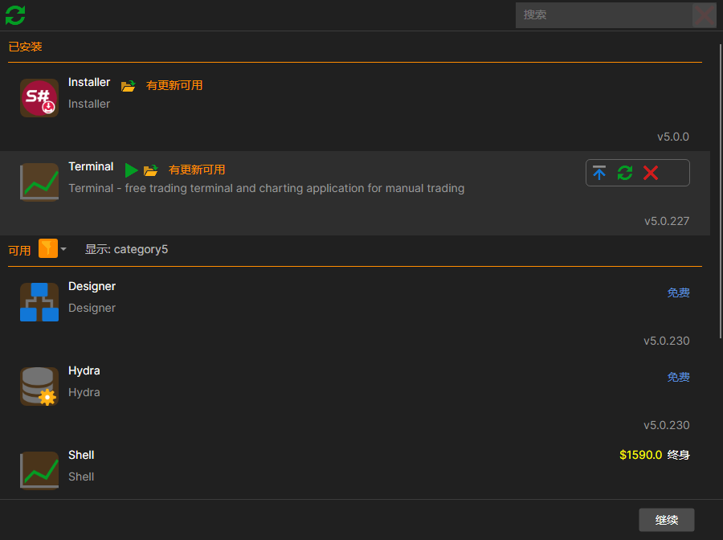
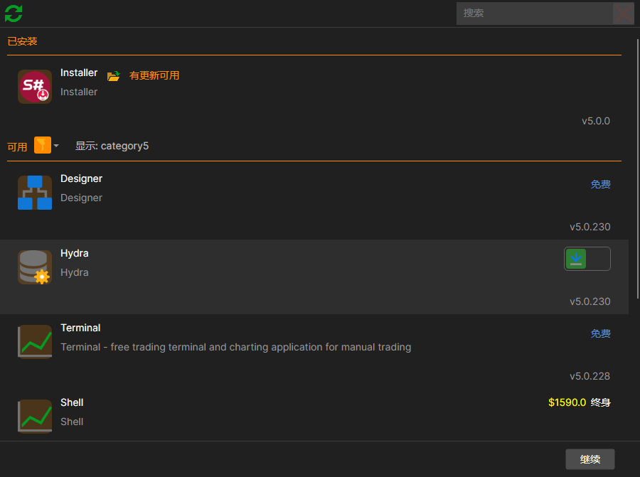
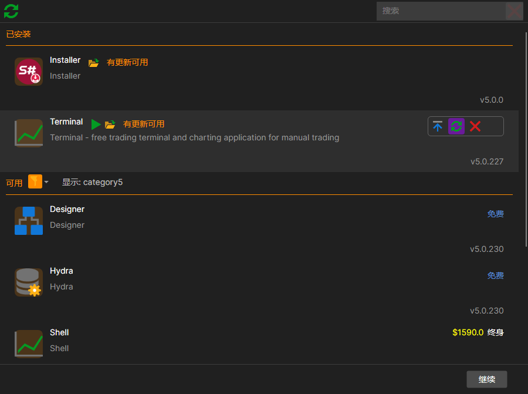
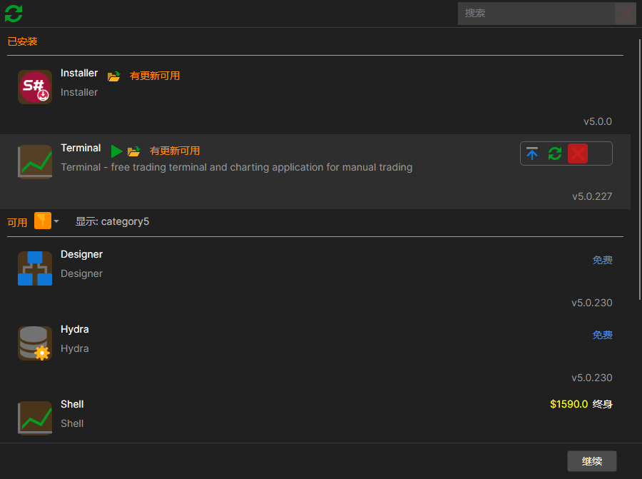
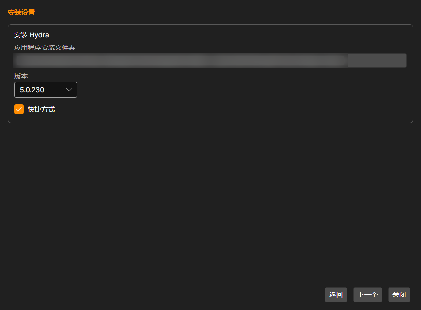

# 安装和卸载应用程序

[安装程序](../installer.md) 对程序执行的所有操作都在 **产品** 选项卡上完成：安装、更新、修复和卸载。在列表中为产品标记操作，然后一次性执行所有已标记的操作。

## 目录

列表分为两部分：**已安装**（此计算机上已安装的产品）和 **可用**（可以安装的产品）。如果某一部分没有内容，则显示 **空的**。

以下功能可帮助查找所需产品：

- 列表上方的 **搜索** 字段：输入时列表会随之缩小，旁边的叉号可恢复完整列表；
- **可用** 标题旁的漏斗图标：按产品类型筛选，**所有** 按钮可取消筛选；
- 左上角带圆形箭头的按钮 **强制检查更新**：立即向商店查询是否有新版本，无需等待下一次定期检查。

已安装产品的行中会显示其版本；如果有新版本，则显示 **有更新可用**。

## 许可协议

窗口底部有一个表示同意的复选框和协议文本的链接。在接受协议之前，无论标记了什么，**继续** 按钮都不可用。协议只需接受一次，并在服务器端记录：此后不再显示该复选框，也无法撤销同意。

## 对产品执行的操作

每行右侧都有一组按钮，从中选择一个。可用的按钮取决于产品：

| 按钮 | 何时可用 | 作用 |
|---|---|---|
| **安装** | 产品未安装 | 安装产品 |
| **更新** | 已安装且有新版本 | 更新产品 |
| **修复** | 已安装 | 重新覆盖安装，不改动设置 |
| **删除** | 已安装 | 卸载产品 |
| **跳过** | 始终可用 | 不对该产品执行任何操作 |

未安装的产品只有一个选择，即安装：

已安装的产品可以选择修复：

以及卸载：

只要至少标记了一项操作，右下角的 **继续** 按钮就会变为可用。可以同时为多个产品标记操作，例如更新一个产品，同时卸载另一个产品。全部标记完成后，单击右下角的 **继续**。

## 向导

随后窗口会显示一个包含三个步骤的向导，取代产品列表。

1. **产品** — 将要执行的具体操作。检查列表，然后单击 **继续**。
2. **安装设置** 

   每项操作都有各自的设置：

   - **应用程序安装文件夹** — 通过按钮选择。**重要！**文件夹必须为空。
   - **版本** 和 **目标** — 安装哪个版本以及为谁安装。
   - **快捷方式** — 在桌面上创建快捷方式。
   - **删除应用数据文件夹** — 仅在卸载时可用：将程序的设置和已下载的数据与程序一起删除。如果不勾选此复选框，这些数据会保留。
   - **插件** — 适用于支持插件的程序：选择与产品一起安装哪些连接器。
   - **安装 主应用程序参数** — 对于带插件的产品，可以取消勾选此复选框，只处理插件而不改动程序本身。

   单击 **下一个**。
3. **将执行以下操作** — 最后一次核对。单击 **执行**。

执行期间会显示 **请稍候...**，完成后显示 **完成**。**关闭** 按钮返回列表；在任何步骤中单击 **返回** 都会回到上一步。

如果操作失败，错误文本会直接显示在向导中，详细信息请参阅[日志](logs.md)页面。

**观看[视频教程](videos/install_and_remove_apps.md)**

## 推荐内容

[更新应用程序](update_apps.md)

[日志](logs.md)
